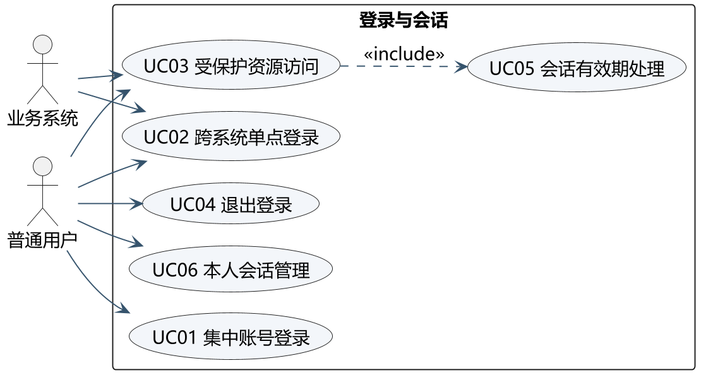
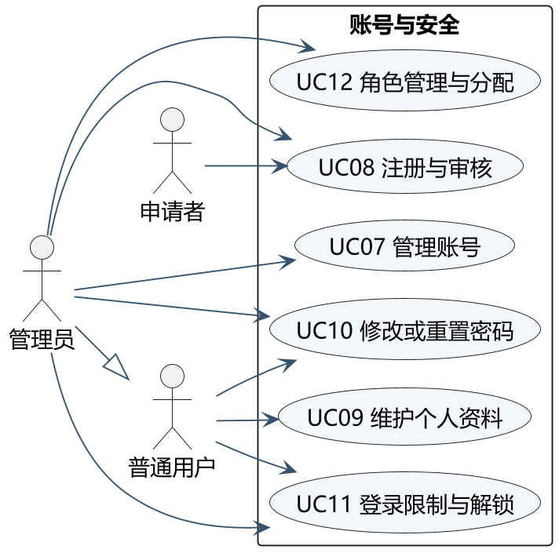
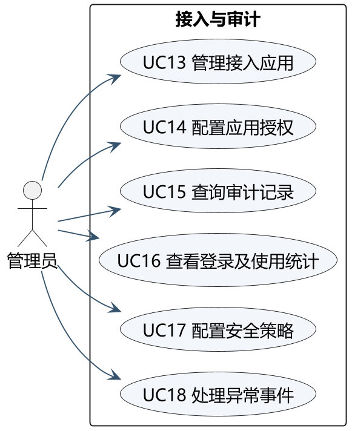
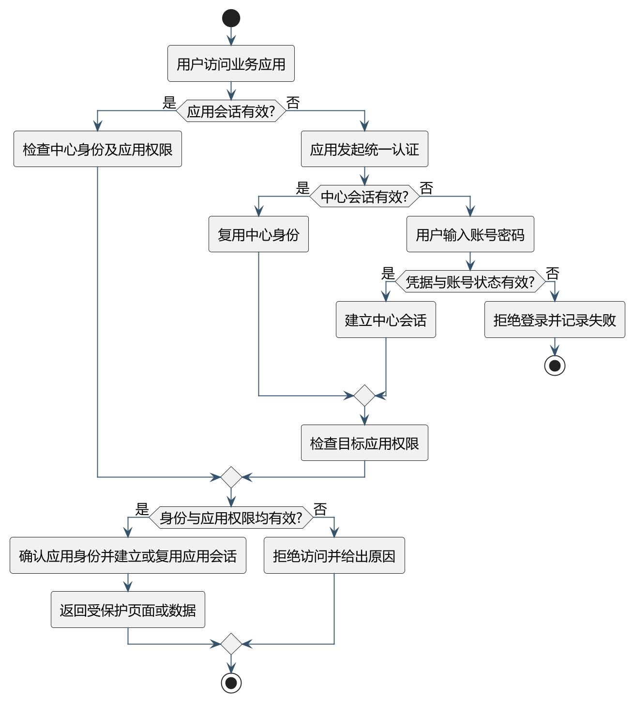
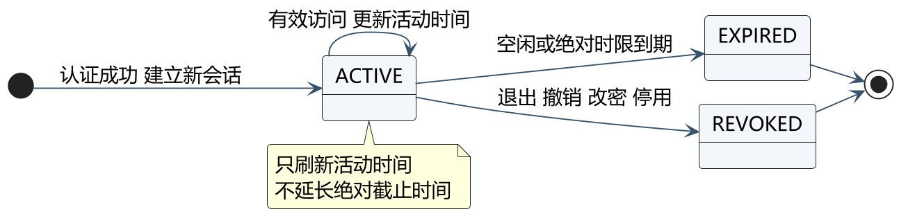
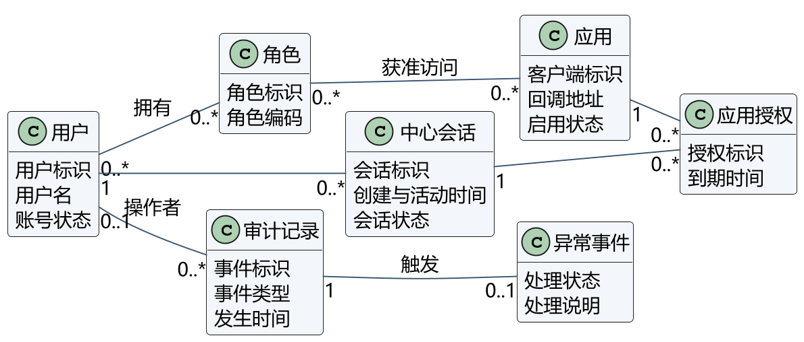
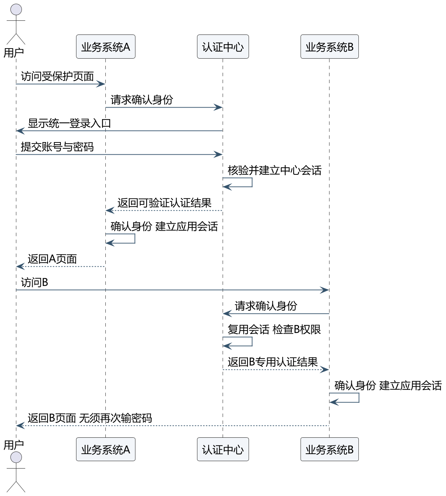
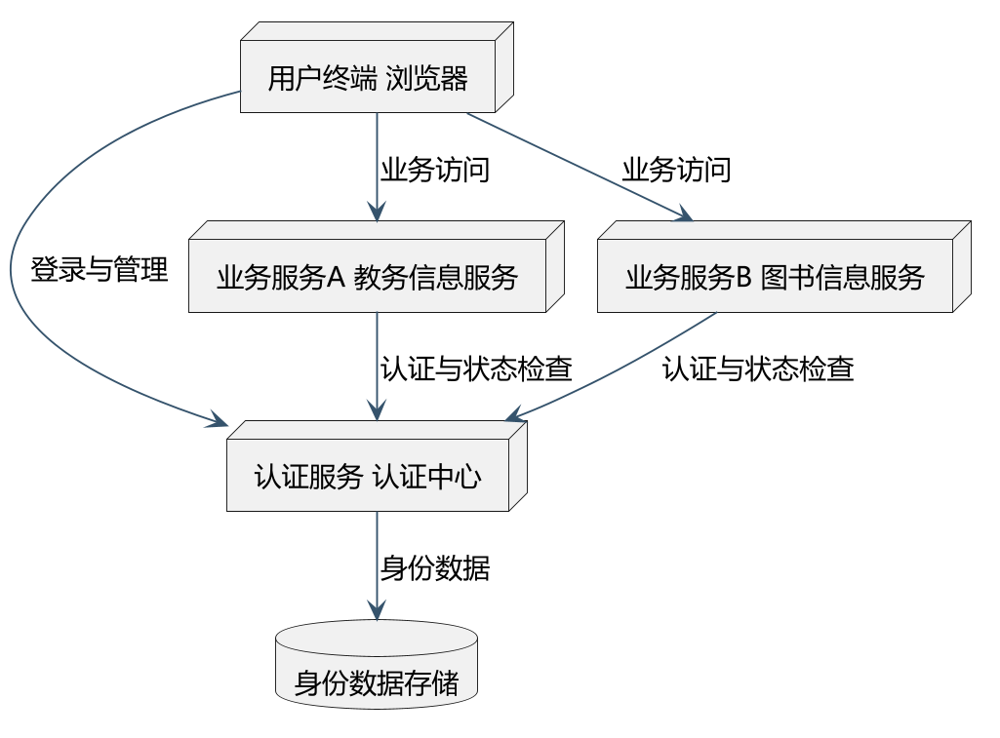

# 统一认证登录软件需求规格说明书

文档编号 SSO-SRS-001

团队成员 李鹏 汪泽洋 文泰龙

## 0 文档说明

### 0.1 与课件结构的对应关系

课件第 11 页规定需求分析文档包含五部分。本文在不改变该结构的前提下增加可编码、可测试的细化内容，对应关系如下。

| 课件要求 | 本文对应章节 | 本文的额外细化 |
| --- | --- | --- |
| 一 概述：目的、市场情况（相关产品分析）、用户类型与特征、操作环境、设计和实现约束 | 第 1 章 | 术语表、利益相关者、假设与依赖、典型业务场景 |
| 二 系统主要功能：主要功能及要求 | 第 2 章 | 功能清单总表、逐项输入校验、错误码、数据影响、可测验收条件 |
| 三 其他需求 | 第 7 章 | 量化指标、测量方法与验收标准 |
| 四 UML 分析模型：部署图、用例图、活动图、状态图、顺序图、类图 | 第 4 章 | 模型与需求的对应说明 |
| 五 数据要求：数据属性定义及限制条件 | 第 5 章 | 字段级数据字典、索引与外键、数据量估算、初始化数据 |
| 课件未单列 | 第 3 章 统一业务规则 | 业务规则编号、状态迁移、权限矩阵、错误码 |
| 课件未单列 | 第 6 章 接口需求 | 需求层接口约束（端点、方法、权限、错误语义） |
| 课件未单列 | 第 8 章 验收与评审 | 验收清单、演示动线、开放问题 |

### 0.2 文档约定

标识前缀：F 功能需求，NFR 非功能需求，BR 业务规则，AC 验收条件，ERR 错误码，UC 用例，TC 测试用例，DR 数据对象。同一编号在需求、设计、测试三份文档中不得改变含义。

用语约定：“必须”表示验收时必须满足的强制要求；“应”表示推荐且允许在评审中说明理由后偏离；“可”表示可选实现，不影响验收结论。凡出现具体数值的要求，均给出取值范围与默认值，不使用“较快”“较多”一类不可测表述。

状态取值一律使用大写英文枚举，与第 3.4 节和第 5 章数据字典保持一致。时间一律以 UTC 存储，界面展示为 Asia/Shanghai。

## 1 概述

### 1.1 目的与背景

本项目面向多个业务系统分别维护账号和登录状态的使用场景，提供集中身份认证和单点登录能力。普通用户使用同一账号进入教务信息服务和图书信息服务，管理员集中维护账号、角色、应用及认证记录。

本文明确系统必须具备的外部行为、数据约束和验收依据，为设计、实现和测试提供统一输入。项目采用三人约 18 项功能的课设规模，功能编号沿用开发计划 F01 至 F18。文档与建模是主要成果，两个业务系统只提供足以验证认证流程的演示功能，不实现完整教务或图书业务。

本文的编写目的是：作为设计说明书的输入，作为测试用例的来源，作为验收时的判定依据。凡本文未规定的行为，实现方不得自行扩大范围；凡本文规定的可观测行为，均须能被测试用例判定为通过或不通过。

### 1.2 读者对象

| 读者 | 关注内容 |
| --- | --- |
| 项目组成员 | 第 2 章功能边界、第 3 章业务规则、第 6 章接口约束，直接决定编码范围 |
| 指导教师与评审人 | 第 0.1 节结构对应、第 2 章功能完整性、第 7 章非功能指标、第 8 章验收清单 |
| 测试执行人 | 第 2 章验收条件、第 3 章错误码与规则、第 5 章数据约束 |
| 后续维护者 | 第 5 章数据字典、第 6 章接口语义、附录 A 追踪摘要 |

### 1.3 相关产品与方案分析

Keycloak 的官方指南覆盖 OIDC 应用接入、账号管理和运行配置。Apereo CAS 以集中登录、服务票据及服务端校验组织认证流程。Spring Authorization Server 提供 OAuth 与 OIDC 协议框架，可供开发者扩展业务管理功能。[R2][R3][R4]

| 方案 | 对本课题的启发 | 本项目取舍 |
| --- | --- | --- |
| Keycloak 成品身份平台 | 集中身份管理、标准应用接入 | 作为功能对照；完整平台配置范围大，不直接替代课程中的自建管理模块 |
| Apereo CAS | 中心认证、独立应用验证凭据 | 借鉴单点登录场景与退出边界；设计阶段比较协议 |
| Spring 认证框架 | 基于现有安全组件扩展业务 | 结合已选择的 Java 技术栈，复用协议实现，编写本项目账号、授权和审计模块 |

上述取舍是课程项目判断，不代表市场占有率、性能排名或已进行产品实测。需求分析依据课件、题目说明和场景分析开展，未开展的用户访谈不写为调研事实。

### 1.4 术语与缩写

| 术语 | 含义 |
| --- | --- |
| 认证中心 | 本系统的核心服务，负责凭据校验、会话维护、授权签发与审计 |
| 业务系统 A、B | 教务信息服务与图书信息服务，作为认证中心的外部客户端 |
| 单点登录（SSO） | 已在一个应用登录的用户访问另一应用时无需重新输入凭据 |
| 中心会话 | 认证中心与浏览器之间的登录状态，以不透明会话标识表示 |
| 应用会话 | 业务系统自身与浏览器之间的登录状态，不复用中心会话标识 |
| 应用授权 | 某个中心会话对某个业务系统的一次可撤销访问许可 |
| 令牌内省 | 业务系统把令牌提交认证中心换取当前有效性的过程，遵循 RFC 7662 |
| 认证版本 | 账号级别的单调递增整数，改密或停用时递增，用于使旧会话失效 |
| 时限快照 | 会话创建时记录的当时策略值，后续策略变更不影响已有会话 |
| 默认拒绝 | 未显式授予的访问一律拒绝，不存在“未配置即放行”的情况 |
| PENDING、ACTIVE、REJECTED、DISABLED | 账号生命周期状态，含义见第 3.4 节 |
| 脱敏摘要 | 记录审计时对敏感值做掩码后的形式，例如密码永不记录、令牌只记前 8 位 |

### 1.5 用户类型与利益相关者

| 角色 | 目标 | 权限边界 |
| --- | --- | --- |
| 申请者 | 提交注册申请并获得审核结果 | 只能提交注册，不能访问任何业务数据 |
| 普通用户 | 登录、访问获授权应用、维护本人资料与会话 | 只能操作本人数据，不能查看他人会话或全局日志 |
| 管理员 | 审核账号、维护账号角色应用策略、查询审计与统计、处理异常事件 | 可管理全局数据，但其管理权限不自动意味着拥有所有业务应用的访问权 |
| 业务系统 A、B | 作为客户端参与认证，验证用户身份与权限 | 不维护中心密码，不信任浏览器自报身份，每次受保护访问按实时关系校验 |

业务系统是与认证中心交互的外部参与者，其后台不能信任浏览器自行填写的用户身份。这一点是后续接口设计必须满足的约束：业务系统的身份来源只能是认证中心签发的令牌或内省结果。

### 1.6 操作环境与约束

目标演示环境为 Windows 10 或 11、现代桌面浏览器和本地网络。设计采用 Java、Spring Boot、MySQL，浏览器页面保持简单。最终可运行版本须在目标环境验证；本阶段不声明已经部署或测试通过。

认证中心与两个业务系统具备独立的客户端身份和本地会话。仅使用不同页面或共享同一个业务会话，不能作为跨系统单点登录的验收证据。协议、数据库物理结构和接口在设计文档中细化。

实现约束：三个服务在同一台机器上以不同端口运行（规划为中心 8080、应用 A 8081、应用 B 8082）；由于浏览器 Cookie 不按端口隔离，三个应用必须使用不同的 Cookie 名称或路径前缀，否则无法演示跨系统单点登录。该约束属强制要求，违反时应视为需求未实现。

### 1.7 范围与非范围

| 属于本期范围 | 不属于本期范围 |
| --- | --- |
| 账号注册、审核、维护、密码与失败锁定 | 短信验证码、邮箱验证、社交账号登录、企业目录对接 |
| 集中登录、跨系统单点登录、受保护访问控制 | 多因素认证、生物识别、硬件令牌 |
| 会话有效期、会话查看与撤销、局部与统一退出 | 高可用集群、跨机房容灾、读写分离 |
| 角色、应用接入、应用访问授权 | 网关限流、灰度发布、服务网格 |
| 审计记录查询、使用统计、安全策略配置、异常事件处理 | 完整教务业务、图书借还与检索业务 |
| 两个业务系统的首页与受保护页面（仅用于验证认证） | 移动端应用、小程序、离线客户端 |

范围判定的依据是能否被第 8 章验收清单直接判定。无法判定、也无对应测试用例的条目，一律不列入本期范围，避免范围膨胀。

### 1.8 假设与依赖

| 编号 | 假设或依赖 | 不成立时的影响 |
| --- | --- | --- |
| A1 | 三个服务可在同一台机器以不同端口启动，端口未被占用 | 演示需更改端口，需同步修改回调白名单 |
| A2 | 浏览器允许第三方会话 Cookie（同一主机不同端口） | 需改用不同主机名或路径隔离方案 |
| A3 | 演示数据量不超过 1000 用户、2 个应用、1 万条审计记录 | 统计查询与列表分页性能指标需重新评估 |
| A4 | 服务端时间可信，不依赖客户端时间判断过期 | 会话过期判定失效，属安全缺陷 |
| A5 | MySQL 8 可用，字符集为 utf8mb4 | 中文显示与排序异常，需在建库脚本中固定 |
| A6 | 演示环境不要求 HTTPS 证书受公网信任，可自签 | 部分浏览器策略会阻止回调，需提前确认教室网络策略 |

### 1.9 典型业务场景

场景一（首次登录与单点访问）：学生首次使用教务信息服务 A。在浏览器访问 A 的首页，被引导至认证中心登录页，输入用户名与密码后回到 A 的原目标页面，页面显示本人姓名。随后在同一浏览器打开图书信息服务 B，未出现登录页即直接进入，且 B 显示的用户与 A 一致。若换一个全新浏览器打开 B，则必须重新输入凭据。该场景用于验证 F01、F02 与 F03。

场景二（撤权与实时失效）：管理员在某学生的角色中移除 A 的访问授权。该学生已登录并在 A 中停留。下一次点击 A 的受保护接口时，A 通过内省得知当前授权已不存在，返回拒绝访问。该场景用于验证 F03、F14，也是本项目“实时授权检查”区别于“只在登录时检查一次”的关键证据。

场景三（账号停用与统一退出）：管理员停用一个存在两个浏览器会话的账号，并对另一个账号执行统一退出。前者两个浏览器的下一次受保护访问均被拒绝，且不能再登录；后者的 A、B 两个应用在下一次受保护访问时均被拒绝，而同一账号在另一浏览器的会话按规则是否保留取决于退出范围。该场景用于验证 F04、F05、F07。

以上三个场景同时构成第 8.2 节演示动线的主体，编码实现时须优先保证其可运行。
## 2 系统功能需求

所有功能纳入本次需求评审范围，按核心流程优先的顺序实现。功能是否完成以本文给出的可观测行为和验收条件为依据；相同功能的两个应用实例或多个按钮不重复计数。

### 2.0 功能清单总表

| 编号 | 功能名称 | 模块 | 负责人 | 参与者 | 优先级 | 复杂度 | 对应规则 |
| --- | --- | --- | --- | --- | --- | --- | --- |
| F01 | 集中账号登录 | AUTH | 李鹏 | 普通用户 | P0 | 高 | BR-07、08、12、26 |
| F02 | 跨系统单点登录 | AUTH | 李鹏 | 普通用户、业务系统 | P0 | 高 | BR-01、02、24 |
| F03 | 受保护资源访问控制 | AUTH | 李鹏 | 普通用户、业务系统 | P0 | 高 | BR-01、19、25 |
| F04 | 退出登录 | SESSION | 李鹏 | 普通用户 | P0 | 中 | BR-17、18、19 |
| F05 | 会话有效期处理 | SESSION | 李鹏 | 普通用户、业务系统 | P0 | 中 | BR-12、13、14 |
| F06 | 用户登录会话管理 | SESSION | 李鹏 | 普通用户 | P1 | 低 | BR-15、16 |
| F07 | 管理员账号管理 | USER | 汪泽洋 | 管理员 | P0 | 中 | BR-28、29、30 |
| F08 | 用户注册与审核 | USER | 汪泽洋 | 申请者、管理员 | P0 | 中 | BR-26、27 |
| F09 | 个人资料维护 | USER | 汪泽洋 | 普通用户 | P1 | 低 | BR-04、30 |
| F10 | 密码维护 | USER | 汪泽洋 | 普通用户、管理员 | P0 | 高 | BR-05、06、15 |
| F11 | 登录失败限制与解锁 | USER | 汪泽洋 | 普通用户、管理员 | P0 | 中 | BR-08、09、10、11 |
| F12 | 角色管理与分配 | ACCESS | 汪泽洋 | 管理员 | P0 | 中 | BR-02、28、30 |
| F13 | 接入应用管理 | APP | 文泰龙 | 管理员 | P0 | 中 | BR-21、22、23 |
| F14 | 应用访问授权 | ACCESS | 文泰龙 | 管理员、普通用户 | P0 | 高 | BR-01、02、03、19 |
| F15 | 审计记录查询 | AUDIT | 文泰龙 | 管理员 | P1 | 中 | BR-31、32、34 |
| F16 | 登录与应用使用统计 | AUDIT | 文泰龙 | 管理员 | P2 | 中 | BR-33、34 |
| F17 | 认证安全策略配置 | POLICY | 文泰龙 | 管理员 | P1 | 中 | BR-35、36 |
| F18 | 异常事件提示与处理 | AUDIT | 文泰龙 | 管理员 | P1 | 低 | BR-37、38、39 |

优先级说明：P0 为必须现场可演示，P1 为必须有界面与数据，P2 为可降级为只读页面。第 6～7 周若工期不足，按 P2、P1 的逆序缩减，P0 不得缩减。

### 2.1 F01 集中账号登录

参与者 普通用户。模块 AUTH。负责人 李鹏。优先级 P0。

前置条件 目标应用已登记且启用；账号存在且处于 ACTIVE；账号未被临时锁定。

输入与校验 用户名必填，4 至 32 字符，转小写后须符合小写字母开头、由小写字母数字下划线组成的规则，长度越界时提示“用户名格式不正确”。密码必填，12 至 64 字符，后端不提示密码复杂度规则以避免泄露策略，仅在校验失败时按 BR-07 统一提示。

正常流程 校验字段；查询账号；判断状态与锁定期限；校验密码散列；建立中心会话并按当前策略写入时限快照；生成授权码前的原请求上下文；返回原访问目标。

异常与错误 凭据错误、账号不存在、账号为 PENDING 或 REJECTED 或 DISABLED、账号处于临时锁定，六种情况一律返回 ERR-AUTH-01（HTTP 401，统一提示“账号或密码错误”），响应体与响应耗时不得可区分，真实原因只写入审计；同一来源短时间重复失败返回 ERR-AUTH-10（HTTP 429）。

后置结果 产生一条中心会话记录（状态 ACTIVE，含时限快照）；写入一条审计事件（LOGIN_SUCCESS 或 LOGIN_FAIL）；密码明文不出现在会话、日志、响应体任何位置。

数据影响 读 sys_user；写 auth_session；写 audit_event；失败时更新 sys_user 的失败计数与窗口起点。

业务规则 BR-07、BR-08、BR-12、BR-26、BR-32。

验收条件

- AC-01-1 输入有效凭据，响应为重定向到原目标，Cookie 中出现会话标识，数据库中新增一条 ACTIVE 会话，审计新增 LOGIN_SUCCESS。
- AC-01-2 输入错误密码，提示为“账号或密码错误”，数据库中不新增会话，审计新增 LOGIN_FAIL 且不含密码字段。
- AC-01-3 输入 PENDING 账号的正确密码，返回 401 且提示与错误密码完全一致，不建立会话，审计记录的真实原因为状态不允许。
- AC-01-4 输入不存在的用户名，响应体与 AC-01-2 完全一致。

追踪 UC01，TC-F01-A、TC-F01-B。

### 2.2 F02 跨系统单点登录

参与者 普通用户、业务系统。模块 AUTH。负责人 李鹏。优先级 P0。

前置条件 同一浏览器已存在有效中心会话；用户拥有目标应用的访问授权；目标应用已登记。

输入与校验 目标应用标识（必须是已登记且启用的 client_id）；返回地址（必须与登记的回调白名单精确匹配）；state 与 nonce 由业务系统生成并在回调时校验；code_challenge 与 code_challenge_method 必须成对出现且方法为 S256。

正常流程 访问 B 的受保护页面；B 生成 state、nonce、code_challenge 并跳转认证中心；认证中心发现有效中心会话，复用而不要求输入凭据；校验 client_id、回调地址与 scope；签发一次性授权码并重定向回 B；B 后端用授权码换取令牌并校验；B 建立自身会话并展示用户身份。

异常与错误 无应用授权返回 ERR-AUTH-05（403，提示“未获得该应用访问权限”）；中心会话已过期返回 ERR-AUTH-04（401，跳转登录页而非直接进入）；回调地址不匹配返回 ERR-AUTH-07（400，不执行跳转）；授权码重复使用返回 ERR-AUTH-08（400，invalid_grant）；缺 code_verifier 返回 ERR-AUTH-08 的 PKCE 变体。

后置结果 B 拥有独立的应用会话；产生一条应用授权记录并关联当前中心会话；审计写入 SSO_AUTHORIZE 事件。

数据影响 写 authorization_link（会话、应用、过期时间）；写 oauth2_auth 中的授权码记录；写 audit_event。

业务规则 BR-01、BR-02、BR-21、BR-24、BR-25。

验收条件

- AC-02-1 登录 A 后在同一浏览器访问 B，B 不出现登录页，且展示的用户名与 A 一致。
- AC-02-2 使用全新浏览器（无中心会话）访问 B，必须出现登录页。
- AC-02-3 将回调地址改为未登记地址，认证中心拒绝跳转且不签发授权码。
- AC-02-4 同一授权码第二次换取令牌，返回 invalid_grant，且第二次不建立会话。

追踪 UC02，TC-F02-A、TC-F02-B。

### 2.3 F03 受保护资源访问控制

参与者 普通用户、业务系统。模块 AUTH。负责人 李鹏。优先级 P0。

前置条件 请求命中受保护页面或数据接口。

输入与校验 浏览器携带的应用会话；业务系统持有的令牌；业务系统向内省端点提交的令牌与客户端凭据。

正常流程 业务系统对每次受保护请求先检查本地会话是否存在，再用令牌调用内省；认证中心校验令牌签名、有效期、会话状态、账号状态与应用授权关系；内省返回 active 为真时业务系统返回数据；为假时按结果分类返回 401 或 403。

异常与错误 页面请求无身份，302 跳转登录；接口请求无身份，ERR-AUTH-04（401）；身份有效但无应用权限，ERR-AUTH-05（403）；认证中心不可达，ERR-AUTH-09（503，且不得降级为放行）；令牌过期，ERR-AUTH-04（401，并清除本地会话）。

后置结果 每个受保护响应都基于服务端实时校验结果；不存在“登录时校验一次、之后长期放行”的路径。

数据影响 读 auth_session、authorization_link、sys_user、role_application；每次内省写一条 TOKEN_INTROSPECT 审计（可按 BR-33 不计入登录统计）。

业务规则 BR-01、BR-19、BR-25。

验收条件

- AC-03-1 直接在地址栏请求受保护接口，未登录返回 401，不返回任何业务数据。
- AC-03-2 已登录但被移除应用授权，下一次接口请求返回 403。
- AC-03-3 手动停掉认证中心后请求受保护接口，返回 503 而不是返回数据。
- AC-03-4 上述三种情况均不出现"页面报错但数据已返回"的情形。

追踪 UC03，TC-F03-A、TC-F03-B。

### 2.4 F04 退出登录

参与者 普通用户。模块 SESSION。负责人 李鹏。优先级 P0。

前置条件 存在中心会话或应用会话。

输入与校验 退出范围（局部退出或统一退出，必须显式提供且不设默认值）；CSRF 令牌；退出后的目标地址必须已登记。

正常流程 局部退出：结束当前应用会话及其应用授权，中心会话保留。统一退出：撤销当前中心会话及其关联的全部应用授权，通知可通知的应用清理本地会话。

异常与错误 重复退出按成功处理（幂等，返回 200）；CSRF 令牌缺失或错误返回 400；目标地址未登记时退回固定首页而非跳转外部地址。

后置结果 局部退出后可凭中心会话再次进入应用；统一退出后 A、B 下一次受保护访问均须重新认证。

数据影响 更新 auth_session 状态为 REVOKED 或保持 ACTIVE；更新 authorization_link 为失效；写 audit_event（LOGOUT_LOCAL 或 LOGOUT_GLOBAL）。

业务规则 BR-17、BR-18、BR-19、BR-20。

验收条件

- AC-04-1 局部退出后访问 B，仍可免密进入，说明中心会话未被误撤销。
- AC-04-2 统一退出后访问 A、B，两者均要求重新登录。
- AC-04-3 统一退出后在另一浏览器（独立中心会话）仍保持登录。
- AC-04-4 连续点击退出两次，第二次响应为成功且不产生新的撤销记录。

追踪 UC04，TC-F04-A、TC-F04-B。

### 2.5 F05 会话有效期处理

参与者 普通用户、业务系统。模块 SESSION。负责人 李鹏。优先级 P0。

前置条件 存在 ACTIVE 状态的中心会话。

输入与校验 服务端当前时间；会话创建时间；最后活动时间；创建时写入的时限快照。

正常流程 每次受保护访问计算空闲时长与总时长；任一达到或超过快照上限即判定过期；过期时把状态置为 EXPIRED、撤销关联授权、要求重新认证；未过期时更新最后活动时间。

异常与错误 边界值按大于或等于处理（恰好等于上限即视为过期）；刷新页面不能延长绝对时限；服务端时间跳变以服务端为准，不使用客户端时间。

后置结果 过期会话不再参与任何授权判定；下次访问表现为需要重新登录。

数据影响 更新 auth_session 的 status 与 last_active_at；撤销 authorization_link；写 audit_event（SESSION_EXPIRED）。

业务规则 BR-12、BR-13、BR-14、BR-40。

验收条件

- AC-05-1 将空闲时限临时设为 1 分钟，静置 61 秒后访问受保护接口，返回 401 且会话状态为 EXPIRED。
- AC-05-2 空闲期内持续操作，会话保持有效且最后活动时间随请求前移。
- AC-05-3 修改策略后新建会话使用新值，既有会话仍按旧快照判定。
- AC-05-4 会话过期后刷新页面仍要求重新登录，不出现“刷新即恢复”。

追踪 UC05，TC-F05-A、TC-F05-B。

### 2.6 F06 用户登录会话管理

参与者 普通用户。模块 SESSION。负责人 李鹏。优先级 P1。

前置条件 用户已登录。

输入与校验 目标会话标识（不透明字符串）；操作意图（结束该会话）。

正常流程 列出本人全部会话的设备摘要、创建时间、最后活动时间、状态；用户选择其中之一结束；结束当前会话时等同局部退出；结束其他会话时仅撤销该会话及其授权。

异常与错误 目标会话不属于当前用户返回 ERR-USER-06（403，且不泄露该会话是否存在）；结束已结束的会话返回成功（幂等）；会话标识格式非法返回 422。

后置结果 被结束的会话立即失效，其他会话不受影响。

数据影响 读 auth_session（按 user_id 过滤）；更新 status 为 REVOKED；写 audit_event（SESSION_REVOKE_BY_USER）。

业务规则 BR-15、BR-16。

验收条件

- AC-06-1 两个浏览器登录同一账号，会话列表出现两条，设备摘要可区分。
- AC-06-2 结束其中一个，另一浏览器的访问不受影响。
- AC-06-3 构造他人会话标识调用接口，返回 403 且不改变该会话状态。

追踪 UC06，TC-F06-A、TC-F06-B。

### 2.7 F07 管理员账号管理

参与者 管理员。模块 USER。负责人 汪泽洋。优先级 P0。

前置条件 管理员身份有效，且其会话未被撤销。

输入与校验 用户名（规则同 F01）；显示名 1 至 64 字符且不含控制字符；邮箱可空，非空时不超过 254 字符且符合邮箱格式；账号状态取值限于四个枚举。

正常流程 创建账号（默认 ACTIVE，密码由管理员设定并标记首次登录须改密）；修改显示名与邮箱；停用账号（递增认证版本并撤销全部会话）；启用账号（不清除历史审计）。

异常与错误 用户名重复返回 ERR-USER-01（409）；停用或降权最后一个有效管理员返回 ERR-USER-02（409）；对存在审计关联的账号执行物理删除时拒绝，提示改为停用。

后置结果 账号状态变更立即影响登录与在途会话；每次变更产生审计记录与操作者标识。

数据影响 写 sys_user；写 audit_event（USER_CREATE、USER_UPDATE、USER_DISABLE、USER_ENABLE）；停用时联动 auth_session。

业务规则 BR-28、BR-29、BR-30。

验收条件

- AC-07-1 创建重名账号返回 409，数据库无新记录。
- AC-07-2 停用账号后，该账号在两个浏览器的下一次受保护访问均返回 401。
- AC-07-3 尝试停用系统唯一管理员，返回 409 且该账号仍为 ACTIVE。
- AC-07-4 每次创建、修改、停用均可按操作者与时间在审计中查到。

追踪 UC07，TC-F07-A、TC-F07-B。

### 2.8 F08 用户注册与审核

参与者 申请者、管理员。模块 USER。负责人 汪泽洋。优先级 P0。

前置条件 用户名未被占用；注册入口公开可访问。

输入与校验 用户名、密码（规则同 F01、BR-05）、显示名、可选邮箱；注册请求中不得包含角色或状态字段，即使包含也应被忽略；审核意见在拒绝时必填，1 至 200 字符。

正常流程 提交申请产生 PENDING 账号；管理员在待审核列表中查看；批准时转为 ACTIVE 并分配 USER 基础角色；拒绝时转为 REJECTED 并保存意见。

异常与错误 PENDING 或 REJECTED 账号尝试登录按 BR-07 统一返回 ERR-AUTH-01；重复审批同一申请返回 409（版本冲突）；注册界面提交管理员角色被忽略而非报错，防止被用于探测内部结构。

后置结果 申请、批准、拒绝三种状态均可复现；拒绝后用户名继续占用，不允许立即被他人注册。

数据影响 写 sys_user（status）；写 user_role（批准时）；写 audit_event（REGISTER、USER_APPROVE、USER_REJECT）。

业务规则 BR-26、BR-27、BR-30。

验收条件

- AC-08-1 提交注册后账号为 PENDING，此时登录被拒，提示与错误密码一致，审计记录状态原因。
- AC-08-2 管理员批准后同一凭据可登录，且自动获得 USER 角色。
- AC-08-3 管理员拒绝后账号为 REJECTED，审计含意见与操作者。
- AC-08-4 用相同用户名再次注册，返回 409。

追踪 UC08，TC-F08-A、TC-F08-B。

### 2.9 F09 个人资料维护

参与者 普通用户。模块 USER。负责人 汪泽洋。优先级 P1。

前置条件 用户已登录且会话有效。

输入与校验 显示名与邮箱，规则同 F07；用户名、账号状态、角色字段在界面上不可编辑，接口接收到这些字段时忽略并记录告警审计。

正常流程 展示本人资料；校验可编辑字段；保存并记录修改前后的摘要；保存后不要求重新登录。

异常与错误 字段超长或邮箱非法返回 ERR-USER-04（422，字段级定位）；尝试修改用户名返回 422 并提示该字段不允许自助修改。

后置结果 资料更新只影响展示信息，不改变任何权限或会话状态。

数据影响 更新 sys_user 的 display_name、email、updated_at；写 audit_event（PROFILE_UPDATE）。

业务规则 BR-04、BR-30。

验收条件

- AC-09-1 修改显示名后，A、B 两处展示同步更新，且无需重新登录。
- AC-09-2 提交超长显示名，返回 422 且原值不变。
- AC-09-3 提交 role 字段篡改请求，角色不变且审计出现告警记录。

追踪 UC09，TC-F09-A、TC-F09-B。
### 2.10 F10 密码维护

参与者 普通用户、管理员。模块 USER。负责人 汪泽洋。优先级 P0。

前置条件 本人修改需先通过旧密码校验；管理员重置需具备账号管理权限。

输入与校验 旧密码必填；新密码 12 至 64 字符，至少含字母与数字，允许特殊字符与空格，不做静默截断；管理员重置生成的一次性初始密码只显示一次，长度 16 位随机字符。

正常流程 校验旧密码；校验新密码是否符合 BR-05 且不与旧密码相同；生成新散列；递增账号认证版本；撤销该账号全部会话；如为管理员重置，标记下次登录必须改密。

异常与错误 旧密码错误返回 ERR-USER-03（422，提示“原密码不正确”）；新密码不符合规则返回 ERR-USER-04（422，字段级定位）；新旧密码相同返回 ERR-USER-05（422）；未改密状态下访问其他功能返回 403，只放行改密与退出。

后置结果 旧密码立即不能登录；改密前建立的全部会话失效；一次性初始密码不出现在日志与响应之外的任何位置。

数据影响 更新 sys_user 的 password_hash、auth_version、must_change_password；更新 auth_session 状态；写 audit_event（PASSWORD_CHANGE、PASSWORD_RESET）。

业务规则 BR-05、BR-06、BR-15。

验收条件

- AC-10-1 在浏览器 1 改密后，浏览器 2 的下一次受保护请求返回 401。
- AC-10-2 用旧密码登录返回 401，用新密码登录成功。
- AC-10-3 提交与旧密码相同的新密码，返回 422 且散列不变。
- AC-10-4 管理员重置后，用户以初始密码登录即被强制跳转改密页。

追踪 UC10，TC-F10-A、TC-F10-B。

### 2.11 F11 登录失败限制与解锁

参与者 普通用户、管理员。模块 USER。负责人 汪泽洋。优先级 P0。

前置条件 发生登录失败尝试，或账号处于临时锁定状态。

输入与校验 账号标识；失败发生时间（服务端时间）；人工解锁操作需管理员权限与理由。

正常流程 记录失败次数与窗口起点；窗口内累计达到阈值时把锁定截止时间写为当前时间加锁定时长；锁定期内每次尝试都拒绝并记录审计；窗口过期或达到锁定截止时间后自动解除；成功登录清零失败计数。

异常与错误 不存在的账号同样累加受来源限速的计数，避免通过响应差异枚举账号；锁定期间提交正确密码仍被拒绝，对外表现为 ERR-AUTH-01，审计记录原因为 LOCKED；人工解锁不改变 DISABLED 状态，两者互不替代。

后置结果 第 5 次失败触发锁定；锁定到期或人工解锁后可重试；每次锁定产生一条异常事件（见 F18）。

数据影响 更新 sys_user 的 failed_count、window_start、locked_until；写 audit_event（LOGIN_FAIL、ACCOUNT_LOCKED、ACCOUNT_UNLOCK）。

业务规则 BR-08、BR-09、BR-10、BR-11。

验收条件

- AC-11-1 连续 5 次错误密码后，第 6 次即使密码正确也被拒绝（401 统一提示），且 locked_until 已写入。
- AC-11-2 锁定到期后（可将锁定时长临时设为 1 分钟）正确密码可登录。
- AC-11-3 管理员解锁后立即可登录，且审计含解锁理由。
- AC-11-4 对 DISABLED 账号执行解锁，账号仍不能登录。

追踪 UC11，TC-F11-A、TC-F11-B。

### 2.12 F12 角色管理与分配

参与者 管理员。模块 ACCESS。负责人 汪泽洋。优先级 P0。

前置条件 管理员身份有效。

输入与校验 角色名称 1 至 40 字符；角色编码 2 至 32 字符，仅大写字母数字下划线且唯一；用户角色集合不得为空引用，不得包含已停用用户。

正常流程 创建或修改角色；为多个用户分配或移除角色；保存关系；变更写入审计；变更在下一次授权判定时生效。

异常与错误 删除系统内置 ADMIN 角色返回 409；把最后一个有效管理员移出 ADMIN 角色返回 ERR-USER-02（409）；重复分配同一角色不产生重复记录且返回成功。

后置结果 角色变更立即影响下一次授权判定，不影响已签发的令牌在有效期内继续有效，但下一次内省将返回失效。

数据影响 写 sys_role、user_role；写 audit_event（ROLE_CREATE、ROLE_UPDATE、ROLE_ASSIGN、ROLE_REVOKE）。

业务规则 BR-02、BR-28、BR-30。

验收条件

- AC-12-1 移除用户角色后，下一次访问该应用返回 403。
- AC-12-2 删除 ADMIN 角色被拒绝，角色仍存在。
- AC-12-3 同一用户重复分配同一角色，关系表仍为一条记录。
- AC-12-4 角色变更在审计中可按操作者与目标用户查询。

追踪 UC12，TC-F12-A、TC-F12-B。

### 2.13 F13 接入应用管理

参与者 管理员。模块 APP。负责人 文泰龙。优先级 P0。

前置条件 管理员身份有效。

输入与校验 应用名称 1 至 60 字符；客户端标识 1 至 100 字符且唯一；至少一条回调地址，单条不超过 512 字符，必须为 HTTPS 且与请求精确匹配，禁止通配符、禁止含片段（#）；应用状态取 ENABLED 或 DISABLED。

正常流程 登记应用并生成客户端凭据；维护回调白名单；停用应用时撤销其全部授权；客户端密钥仅在创建时完整显示一次，之后只显示掩码。

异常与错误 客户端标识重复返回 ERR-APP-01（409）；回调地址含通配符、片段或非 HTTPS 返回 ERR-APP-02（422）；停用后尝试发起授权返回 ERR-AUTH-06（403）。

后置结果 两个业务应用各持独立客户端身份；停用应用不能换取新令牌，已有访问在下一次内省时被拒。

数据影响 写 app_profile（含 client_secret_hash）；停用时更新 authorization_link；写 audit_event（APP_CREATE、APP_UPDATE、APP_DISABLE）。

业务规则 BR-21、BR-22、BR-23。

验收条件

- AC-13-1 登记回调地址为 http:// 或含通配符时被拒绝，库中无该应用。
- AC-13-2 客户端密钥第二次显示为掩码，明文不可再获取。
- AC-13-3 停用应用 B 后访问 B 返回 403，A 不受影响。

追踪 UC13，TC-F13-A、TC-F13-B。

### 2.14 F14 应用访问授权

参与者 管理员、普通用户。模块 ACCESS。负责人 文泰龙。优先级 P0。

前置条件 角色与应用均处于有效状态。

输入与校验 角色标识与应用标识必须存在且启用；授权关系为组合唯一；不存在“全部应用”通配授权。

正常流程 管理员配置某角色可访问的应用集合；用户访问应用时按实时关系判定：用户持有的任一有效角色被授权该应用即可进入；判定发生在每次受保护访问，而非仅登录时。

异常与错误 未授权访问返回 ERR-AUTH-05（403）；管理员管理权限不具备业务应用访问权（BR-03）；撤权后已签发的令牌在下一次内省返回 active 为假。

后置结果 授权变更在下一次请求即生效，不存在缓存导致的长期放行。

数据影响 写 role_application；写 audit_event（APP_GRANT、APP_REVOKE）；读时联查 user_role 与 role_application。

业务规则 BR-01、BR-02、BR-03、BR-19。

验收条件

- AC-14-1 拥有 A 授权的用户可进入 A，访问 B 返回 403。
- AC-14-2 移除 A 授权后，用户已在 A 中停留，下一次接口请求返回 403。
- AC-14-3 管理员账号未获 B 授权时，同样不能进入 B。

追踪 UC14，TC-F14-A、TC-F14-B。

### 2.15 F15 审计记录查询

参与者 管理员。模块 AUDIT。负责人 文泰龙。优先级 P1。

前置条件 管理员身份有效且存在审计数据。

输入与校验 时间区间（左闭右开，跨度不超过 90 天）；事件类型；用户；应用；结果；页码从 1 开始，页大小 1 至 100。

正常流程 按条件过滤并分页返回；展示脱敏摘要、操作者、发生时间、结果、请求标识；支持按请求标识追踪同一次请求内的多条事件。

异常与错误 跨度超过 90 天返回 ERR-AUD-01（422）；页大小超过 100 返回 ERR-AUD-02（422）；普通用户访问返回 403。

后置结果 查询结果与同条件统计一致；查询本身写一条 AUDIT_QUERY 事件，避免审计被无痕翻阅。

数据影响 读 audit_event；写 audit_event（AUDIT_QUERY）。

业务规则 BR-31、BR-32、BR-34。

验收条件

- AC-15-1 页大小填 101 返回 422，填 100 返回成功。
- AC-15-2 区间跨度 91 天返回 422，90 天返回成功。
- AC-15-3 结果中不出现密码、完整令牌或客户端密钥。
- AC-15-4 普通用户调用该接口返回 403。

追踪 UC15，TC-F15-A、TC-F15-B。

### 2.16 F16 登录与应用使用统计

参与者 管理员。模块 AUDIT。负责人 文泰龙。优先级 P2。

前置条件 存在审计数据。

输入与校验 时间区间（同 F15 约束）；分组维度为按日或按应用；指标固定为凭据登录成功、凭据登录失败、单点认证成功、应用授权成功四类。

正常流程 按条件聚合计数并按分组返回；无数据的分组返回 0 而不是缺省；同一请求内的内省记录不计作登录。

异常与错误 区间非法返回 ERR-AUD-01；不支持的指标名返回 400。

后置结果 任一指标与同条件审计明细计数一致。

数据影响 只读 audit_event。

业务规则 BR-33、BR-34。

验收条件

- AC-16-1 统计的登录成功数与审计中 LOGIN_SUCCESS 条数一致。
- AC-16-2 刷新统计页面不会使计数增加。
- AC-16-3 空区间返回各项为 0 的完整结构。

追踪 UC16，TC-F16-A、TC-F16-B。

### 2.17 F17 认证安全策略配置

参与者 管理员。模块 POLICY。负责人 文泰龙。优先级 P1。

前置条件 管理员身份有效。

输入与校验 空闲时限 5 至 120 分钟；绝对时限 1 至 24 小时；失败窗口 5 至 60 分钟；失败阈值 3 至 10 次；锁定时长 5 至 60 分钟；空闲时限不得大于绝对时限；提交时携带版本号。

正常流程 校验参数范围与关联约束；保存为新版本并记录更新者；新参数对新建会话与新失败窗口生效；已锁定账号保持原截止时间。

异常与错误 参数越界或空闲时限大于绝对时限返回 ERR-POL-01（422）；版本号与当前不一致返回 ERR-POL-02（409）。

后置结果 合法配置立即生效且可追踪；非法值不落库；已有会话沿用创建时快照。

数据影响 写 security_policy（版本递增，保留历史行）；写 audit_event（POLICY_UPDATE）。

业务规则 BR-35、BR-36。

验收条件

- AC-17-1 空闲时限填 130 分钟返回 422。
- AC-17-2 空闲时限大于绝对时限返回 422。
- AC-17-3 两个浏览器同时提交，后提交者返回 409。
- AC-17-4 修改后新建会话使用新值，既有会话仍按旧值过期。

追踪 UC17，TC-F17-A、TC-F17-B。

### 2.18 F18 异常事件提示与处理

参与者 管理员。模块 AUDIT。负责人 文泰龙。优先级 P1。

前置条件 账号锁定等条件产生异常事件。

输入与校验 事件标识；处理动作；处理说明在关闭时 1 至 500 字符且不允许全空白；版本号用于并发控制。

正常流程 锁定发生时创建 OPEN 事件；管理员确认转为 ACKNOWLEDGED；填写说明后关闭为 CLOSED；列表按状态与时间可查询。

异常与错误 关闭时未填说明返回 ERR-EVT-01（422）；从 OPEN 直接跳 CLOSED 或对已关闭事件再次关闭返回 ERR-EVT-02（409）；同一次锁定因日志重试重复上报时不生成重复事件。

后置结果 状态按规定迁移；处理人与处理时间完整；关闭事件不自动解锁账号（解锁是独立动作）。

数据影响 写 security_event（status、handler_id、note、version）；写 audit_event（SECURITY_EVENT_ACK、SECURITY_EVENT_CLOSE）。

业务规则 BR-37、BR-38、BR-39。

验收条件

- AC-18-1 触发锁定的同时生成一条 OPEN 事件，重复触发不增加条数。
- AC-18-2 关闭时不填说明返回 422，事件仍为 ACKNOWLEDGED。
- AC-18-3 关闭事件后账号仍处于锁定，直至到期或人工解锁。

追踪 UC18，TC-F18-A、TC-F18-B。

### 2.19 关键场景的详细交互

本节把第 1.9 节的三段叙述展开为可实现的交互序列，用于设计阶段的顺序图核对与测试用例编写。序列中的状态码为对外可观测结果，业务系统内部实现方式不作规定。

场景一 首次登录与单点访问

1. 浏览器 GET 应用 A 的 /home，A 无本地会话，302 到认证中心 /oauth2/authorize 并携带 client_id、redirect_uri、state、nonce、code_challenge、code_challenge_method=S256。
2. 认证中心无有效中心会话，渲染登录页；提交用户名与密码。
3. 认证中心校验通过，写入 auth_session（含时限快照），302 回 A 的 redirect_uri 并附一次性 code。
4. A 后端 POST /oauth2/token 提交 code 与 code_verifier，获得 id_token 与 access_token；校验 nonce 与签名。
5. A 建立本地会话，返回 /home，页面显示用户名。
6. 浏览器 GET 应用 B 的 /home，B 无本地会话，302 到 /oauth2/authorize。
7. 认证中心发现有效中心会话，不再要求输入凭据，直接签发 code，302 回 B。
8. B 换码并获得令牌，建立本地会话，展示同一用户。

场景二 撤权后的实时失效

1. 管理员在管理台移除角色 R 对应用 A 的授权，写 role_application 与审计。
2. 学生仍在 A 页面中，点击 /api/books（受保护接口）。
3. A 以当前 access_token 调用认证中心 /oauth2/introspect。
4. 认证中心联查会话状态、账号状态与授权关系，返回 active=false 并给出失效原因码。
5. A 清除本地会话，接口返回 403 或 401（按原因码区分），页面提示无权限。

场景三 停用账号与统一退出

1. 管理员停用账号 U，递增 auth_version，撤销 U 的全部 auth_session，写审计。
2. U 在浏览器 1 的下一次受保护请求触发内省，返回 active=false，A 返回 401。
3. U 在浏览器 2 同样被拒，两处表现一致。
4. 另一账号 V 执行统一退出，撤销当前中心会话与其全部 authorization_link。
5. V 在同一浏览器的 A、B 下一次请求均返回 401；V 在另一浏览器的会话按 BR-17 不受影响。
## 3 统一业务规则

### 3.1 身份与授权

身份认证回答用户是谁，应用授权决定用户能否进入特定应用。默认拒绝访问，用户只要持有一个有效且获应用授权的角色即可访问。ADMIN 角色赋予管理权限，不自动绕过业务应用授权。管理员自身的管理请求也须校验账号、会话和角色状态。

授权判定顺序固定为：会话是否有效；账号是否为 ACTIVE 且不在锁定期；应用是否 ENABLED；用户是否存在至少一个有效角色；该角色是否被授权该应用。任一步不通过即拒绝，且不继续后续判断，避免把拒绝原因泄露为可枚举的信息。

### 3.2 会话与退出

中心会话与业务会话分别存在。统一退出作用于当前浏览器对应的中心会话及其关联授权，其他浏览器会话继续有效。修改密码、重置密码、停用账号撤销该账号全部会话。结束指定会话只影响该会话。停用应用撤销该应用全部授权。

失效或撤权后，下一个受保护请求不得返回业务数据。已经发送到浏览器的历史页面内容不会被远程收回，刷新或新的接口调用须执行校验。局部退出后重新进入应用，若中心会话仍有效，可再次自动登录。

### 3.3 默认策略

| 策略 | 默认值 | 允许范围与约束 |
| --- | --- | --- |
| 中心会话空闲时限 | 30 分钟 | 5 至 120 分钟，且不得大于绝对时限 |
| 中心会话绝对时限 | 8 小时 | 1 至 24 小时 |
| 失败统计窗口 | 15 分钟 | 5 至 60 分钟 |
| 失败锁定阈值 | 5 次 | 3 至 10 次 |
| 临时锁定时长 | 15 分钟 | 5 至 60 分钟 |
| 密码长度 | 12 至 64 字符 | 至少包含字母和数字，允许特殊字符与空格，不自动截断 |
| 授权码有效期 | 60 秒 | 一次性使用，不随请求延长 |
| 访问令牌有效期 | 10 分钟 | 不签发刷新令牌 |
| 审计查询跨度 | 最多 90 天 | 超出需分批查询 |
| 审计页大小 | 最多 100 条 | 默认 20 条 |
| 显示名长度 | 1 至 64 字符 | 不含控制字符 |
| 邮箱长度 | 最长 254 字符 | 可空，非空时校验格式 |

新策略的会话参数只影响新会话。失败参数只影响新建立的失败统计窗口，已锁定账号保持原截止时间。用户名统一转小写，匹配小写字母开头、由小写字母数字下划线组成的 4 至 32 字符规则。

### 3.4 状态与时间

账号状态为 PENDING、ACTIVE、REJECTED、DISABLED；临时锁定另用 locked_until 表示，避免与账号生命周期混淆。会话状态为 ACTIVE、EXPIRED、REVOKED。应用状态为 ENABLED、DISABLED。异常事件状态为 OPEN、ACKNOWLEDGED、CLOSED。

| 对象 | 允许的迁移 | 触发者 | 禁止的迁移 |
| --- | --- | --- | --- |
| 账号 | PENDING→ACTIVE（批准）、PENDING→REJECTED（拒绝）、ACTIVE→DISABLED（停用）、DISABLED→ACTIVE（启用） | 管理员 | REJECTED→ACTIVE 直接恢复；任何状态被物理删除 |
| 会话 | ACTIVE→EXPIRED（时限到达）、ACTIVE→REVOKED（退出、改密、停用、手动结束）、EXPIRED→ACTIVE | 系统、用户、管理员 | 已 EXPIRED 或 REVOKED 的会话恢复为有效 |
| 应用授权 | 有效→失效（退出、撤权、停用应用、会话终止） | 用户、管理员、系统 | 失效授权重新变为有效（须重新走认证） |
| 异常事件 | OPEN→ACKNOWLEDGED→CLOSED | 管理员 | OPEN 直接跳 CLOSED；已 CLOSED 再次关闭 |

存储时间统一采用 UTC，展示和按日汇总采用 Asia/Shanghai。查询区间使用左闭右开 [开始, 结束)，结束时间不计入。所有会话判定采用服务端时间，不能由浏览器提供的时间决定。

### 3.5 业务规则清单

本表是第 2 章各功能的公共约束来源。测试用例可直接引用规则编号，需求变更时先改规则再改功能描述，避免同一事实在多处漂移。

| 编号 | 规则 | 相关功能 |
| --- | --- | --- |
| BR-01 | 默认拒绝：未显式授予的访问一律拒绝，不存在未配置即放行 | F02、F03、F14 |
| BR-02 | 用户须持有至少一个有效角色，且该角色被授权目标应用 | F02、F12、F14 |
| BR-03 | 管理权限不等于业务应用访问权 | F14 |
| BR-04 | 用户名转小写后 4 至 32 字符，小写字母开头，仅小写字母数字下划线，唯一且不可自助修改 | F01、F09 |
| BR-05 | 密码 12 至 64 字符，至少含字母与数字，允许特殊字符与空格，不静默截断 | F01、F10 |
| BR-06 | 密码只以自适应散列保存，明文不落库、不入日志、不回显 | F10 |
| BR-07 | 登录失败对外提示统一，不区分账号不存在、密码错误与状态异常 | F01 |
| BR-08 | 15 分钟窗口内累计 5 次失败锁定 15 分钟，成功登录清零窗口 | F01、F11 |
| BR-09 | 锁定期间即使密码正确也拒绝 | F11 |
| BR-10 | 窗口过期或达到锁定截止时间后自动解除 | F11 |
| BR-11 | 人工解锁不改变账号停用状态 | F11 |
| BR-12 | 会话空闲 30 分钟、绝对 8 小时，任一达到即过期，边界按大于或等于判定 | F01、F05 |
| BR-13 | 会话时限使用创建时快照，策略变更只影响新会话 | F05、F17 |
| BR-14 | 会话过期后不能通过刷新页面恢复 | F05 |
| BR-15 | 改密、重置、停用使认证版本递增，该账号全部会话失效 | F07、F10 |
| BR-16 | 结束指定会话只影响该会话 | F06 |
| BR-17 | 统一退出撤销当前中心会话及其全部关联授权，不影响其他浏览器会话 | F04 |
| BR-18 | 局部退出只结束当前应用会话及其授权，中心会话仍有效 | F04 |
| BR-19 | 撤销后下一个受保护请求必须拒绝，不返回业务数据 | F03、F04、F14 |
| BR-20 | 已渲染的历史页面无法远程收回，验收边界为事务提交后的下一次请求 | F04 |
| BR-21 | 回调地址必须 HTTPS、精确匹配、禁止通配符与片段 | F02、F13 |
| BR-22 | 客户端标识唯一，客户端密钥仅服务端使用且只在创建时完整显示 | F13 |
| BR-23 | 停用应用撤销其全部授权，不能换取新令牌 | F13 |
| BR-24 | 授权码一次性、有效期 60 秒；访问令牌 10 分钟；不签发刷新令牌 | F02 |
| BR-25 | 内省响应必须包含 active 字段，业务系统只依据该字段判定 | F03 |
| BR-26 | PENDING、REJECTED、DISABLED 账号不得登录 | F01、F08 |
| BR-27 | 注册不能指定角色；批准时分配 USER 基础角色 | F08 |
| BR-28 | 禁止停用或降权最后一个有效管理员 | F07、F12 |
| BR-29 | 有审计关联的账号不物理删除，只停用 | F07 |
| BR-30 | 账号、角色、应用、策略、授权变更必须写审计 | F07 至 F14、F17 |
| BR-31 | 审计最大页大小 100，查询跨度最多 90 天 | F15 |
| BR-32 | 审计不记录密码、完整令牌与客户端密钥 | F01、F15 |
| BR-33 | 统计口径：凭据登录成功、凭据登录失败、单点认证、应用授权分别计数；内省不计登录 | F16 |
| BR-34 | 查询区间左闭右开，按日统计以 Asia/Shanghai 划分 | F15、F16 |
| BR-35 | 策略参数须在允许范围内，且空闲时限不得大于绝对时限 | F17 |
| BR-36 | 策略与事件修改使用版本号，冲突返回 409 | F17、F18 |
| BR-37 | 异常事件按 OPEN→ACKNOWLEDGED→CLOSED 流转，关闭必须填写说明 | F18 |
| BR-38 | 同一锁定来源只生成一项异常事件，日志重试不重复 | F18 |
| BR-39 | 关闭异常事件不自动解锁账号 | F18 |
| BR-40 | 所有判定使用服务端 UTC 时间，客户端时间不参与 | F01、F05、F15 |

### 3.6 权限矩阵

矩阵中的“本人”表示只能操作与当前登录用户相关的数据。管理类操作同时要求会话有效、账号 ACTIVE 且持有 ADMIN 角色。

| 操作 | 申请者（未登录） | 普通用户 | 管理员 |
| --- | --- | --- | --- |
| 提交注册申请 | 允许 | 允许 | 允许 |
| 登录、退出、改密 | 不允许 | 允许 | 允许 |
| 查看与结束本人会话 | 不允许 | 允许 | 允许 |
| 维护本人资料 | 不允许 | 允许 | 允许 |
| 访问业务应用 A、B | 不允许 | 需应用授权 | 需应用授权 |
| 审核注册申请 | 不允许 | 不允许 | 允许 |
| 创建、修改、停用账号 | 不允许 | 不允许 | 允许 |
| 重置他人密码 | 不允许 | 不允许 | 允许 |
| 解锁账号 | 不允许 | 不允许 | 允许 |
| 维护角色与分配 | 不允许 | 不允许 | 允许 |
| 登记与停用应用 | 不允许 | 不允许 | 允许 |
| 配置角色与应用授权 | 不允许 | 不允许 | 允许 |
| 查询审计与统计 | 不允许 | 不允许 | 允许 |
| 配置认证策略 | 不允许 | 不允许 | 允许 |
| 处理异常事件 | 不允许 | 不允许 | 允许 |

### 3.7 错误码与对外提示

错误码是接口与测试的公共约定，与设计文档第 6.5 节的状态码语义保持一致。状态码分层为：401 表示未认证或凭据不被接受；403 表示已认证但无权限或应用停用；400 仅用于协议参数缺失、CSRF 校验失败与 OAuth 参数错误；409 用于版本冲突、唯一性重复与业务状态机非法流转；422 用于字段、参数与取值不合法；429 用于限速；503 用于依赖不可用且必须 fail closed。

| 错误码 | HTTP | 对外提示 | 触发条件 |
| --- | --- | --- | --- |
| ERR-AUTH-01 | 401 | 账号或密码错误 | 凭据错误、账号不存在、状态不允许登录或临时锁定，真实原因只入审计 |
| ERR-AUTH-04 | 401 | 登录已失效，请重新登录 | 会话不存在、过期或已撤销；内省返回 active 为假 |
| ERR-AUTH-05 | 403 | 未获得该应用访问权限 | 无有效角色，或角色未被授权该应用 |
| ERR-AUTH-06 | 403 | 该应用已停用 | 应用状态为 DISABLED |
| ERR-AUTH-07 | 400 | 应用回调地址不合法 | 回调地址与白名单不精确匹配，属协议参数错误 |
| ERR-AUTH-08 | 400 | 授权请求无效或已使用 | 授权码重复使用、过期、PKCE 校验失败 |
| ERR-AUTH-09 | 503 | 认证服务暂不可用，请稍后重试 | 认证中心或数据库不可达，不得降级放行 |
| ERR-AUTH-10 | 429 | 尝试过于频繁，请稍后重试 | 来源或账号维度触发限速 |
| ERR-USER-01 | 409 | 用户名已被占用 | 注册或创建账号时重名 |
| ERR-USER-02 | 409 | 不能对最后一个管理员执行该操作 | 停用或降权唯一有效管理员 |
| ERR-USER-03 | 422 | 原密码不正确 | 改密时旧密码校验失败 |
| ERR-USER-04 | 422 | 字段内容不符合要求 | 长度、格式或字符集越界 |
| ERR-USER-05 | 422 | 新密码不能与原密码相同 | 新旧散列一致 |
| ERR-USER-06 | 403 | 无权操作该会话 | 目标会话不属于当前用户 |
| ERR-APP-01 | 409 | 客户端标识已存在 | 登记应用时客户端标识重复 |
| ERR-APP-02 | 422 | 回调地址不符合要求 | 非 HTTPS、含通配符或含片段 |
| ERR-POL-01 | 422 | 策略参数超出允许范围 | 任一参数越界，或空闲时限大于绝对时限 |
| ERR-POL-02 | 409 | 配置已被他人修改，请刷新后重试 | 版本号不一致 |
| ERR-AUD-01 | 422 | 查询时间跨度超过上限 | 超过 90 天 |
| ERR-AUD-02 | 422 | 分页参数超出上限 | 页大小大于 100 或页码小于 1 |
| ERR-EVT-01 | 422 | 请填写处理说明 | 关闭事件时说明为空或全空白 |
| ERR-EVT-02 | 409 | 事件状态不允许该操作 | 状态机非法流转或重复关闭 |

登录类错误统一使用 ERR-AUTH-01，是为了满足 BR-07 的防枚举要求：账号不存在、密码错误、待审核、已拒绝、已停用与临时锁定六种情况，对外提示与响应耗时不得可区分，真实原因只写入审计记录。锁定期间不对外提示剩余时间，避免被用于推测策略参数。

错误提示文案由服务端统一返回，前端不得自行改写；同一错误码在不同页面保持一致；审计记录错误码而不记录提示文案，便于按码统计。
## 4 UML 分析模型

模型以需求行为为中心，设计文档进一步细化协议与组件。可编辑源文件位于交付目录的 UML模型 文件夹，图号在模型说明中保持一致。以下六组模型与第 2、3 章内容一一对应，评审时按“图—功能—规则”三处对照。

### 4.1 参与者与用例

图 A01、A07 和 A08 共同覆盖 18 项功能。申请者使用公开注册入口，管理员除具备普通用户能力外，还能管理全局数据。业务系统参与登录结果验证与受保护访问，不直接维护中心密码。

A07 覆盖 F07 至 F12，重点表达账号生命周期与安全策略的边界：审核、停用、锁定与解锁是不同动作，A07 中的转移不得合并为“封号”一类模糊表述。

A08 覆盖 F13 至 F18，把应用接入、访问授权、审计查询、统计与异常处理分开表达，避免把审计与统计混为一项。

### 4.2 跨系统访问活动

分支体现中心是否已有有效会话，以及用户是否具有应用权限。无权限和认证失败均不能到达业务数据返回节点。图中的判定顺序与第 3.1 节规定的授权判定顺序一致，实现时不得调换。

### 4.3 会话状态

到期与撤销是终止状态。再次登录建立新会话，不复活旧会话。查看会话记录不等于刷新其有效状态。该图对应 BR-12 至 BR-16 与第 3.4 节的状态迁移表。

### 4.4 概念类与关系

用户和角色、角色和应用均为多对多关系。一个用户可拥有多个会话，一个会话可关联多个应用授权。审计记录保留发生时的身份摘要，不依赖关联表仍然存在。概念类与第 5 章数据对象的对应关系见附录 A。

### 4.5 场景顺序与部署边界

顺序图描述首次登录与进入第二应用的业务顺序，与第 2.19 节场景一的 8 个步骤一致。协议细节在设计模型 D02 中表达，需求层只约束可观测结果：第二次访问不出现登录页、两处显示同一用户。

部署图强调三套服务边界：认证中心与两个业务系统为独立进程，共享一个数据库实例。该边界是“跨系统单点登录”可验证的前提，若合并为单进程，F02 的验收条件将无法成立。
## 5 数据需求

本章定义数据对象、字段约束与初始化要求。字段命名与设计文档第 5 章的物理表保持一致，避免同一含义出现两套名称；设计文档可以增加索引与触发器，但不得放宽本节约束。

### 5.1 数据对象总览

| 数据对象 | 物理表 | 必需属性 | 主要约束 |
| --- | --- | --- | --- |
| 用户 | sys_user | 唯一标识、用户名、密码散列、显示名、状态、失败与锁定快照、认证版本、审核信息 | 用户名唯一且不允许自助改名；密码不以明文保存；状态限枚举 |
| 角色 | sys_role | 唯一标识、编码、名称、启用标志、系统角色标志 | 编码唯一；ADMIN 为系统角色不可删除 |
| 用户角色关系 | user_role | 用户标识、角色标识 | 组合主键唯一；引用对象必须存在 |
| 应用 | app_profile | 唯一标识、注册客户端标识、应用编码、显示名、状态 | 客户端标识与应用编码均唯一 |
| 回调地址 | oauth2_registered_client | 客户端标识、回调地址集合 | HTTPS、精确匹配、禁止通配符与片段 |
| 角色应用关系 | role_application | 角色标识、应用标识 | 组合主键唯一；默认无授权 |
| 中心会话 | auth_session | 会话标识、用户、运行会话摘要、时间三要素、时限快照、状态 | 标识不可预测；时间关系自洽 |
| 授权会话关联 | authorization_session_link | 授权标识、会话标识、客户端标识、版本快照 | 授权与中心会话一一对应 |
| 授权与令牌 | oauth2_authorization | 授权标识、客户端、主体、授权方式、令牌有效期 | 授权码一次性、短时；不签发刷新令牌 |
| 安全策略 | security_policy | 各时限、阈值、版本、更新者 | 单例；参数在规定范围内 |
| 审计记录 | audit_event | 事件键、类型、结果、时间、操作者、应用、请求标识 | 事件键唯一；敏感值不记录 |
| 异常事件 | security_event | 来源审计、状态、处理人、关闭原因、版本 | 每个锁定来源仅一项；关闭须有原因 |

### 5.2 字段级数据字典

以下字典是编码与建表的直接依据。类型与长度不得随意放宽，可空性不得随意收紧；新增字段须同步更新本节与设计文档。

DR-01 用户表 sys_user

| 字段 | 类型与长度 | 空值与默认 | 键与约束 | 说明 |
| --- | --- | --- | --- | --- |
| id | BIGINT | 非空 | PK | 用户标识，不由外部提交 |
| username | VARCHAR(32) | 非空 | UK；4 至 32 字符；小写 | 登录名，参与登录唯一性判断 |
| password_hash | VARCHAR(255) | 非空 | 仅安全散列 | 禁止日志输出与接口回显 |
| display_name | VARCHAR(64) | 非空 | 不含控制字符 | 界面显示名称，允许中文 |
| email | VARCHAR(254) | 可空 | 非空时校验邮箱格式 | 仅作联系资料，不用于找回密码 |
| status | VARCHAR(16) | 非空 | PENDING、ACTIVE、REJECTED、DISABLED | 账号生命周期状态 |
| must_change_password | BOOLEAN | false |  | 为真时只允许改密与退出 |
| auth_version | BIGINT | 0 | 非负 | 改密、重置、停用递增，使旧会话失效 |
| failed_count | INT | 0 | 非负 | 当前失败窗口内的失败次数 |
| failed_window_start | DATETIME(6) | 可空 | 不晚于当前时间 | 失败窗口起点，UTC |
| failed_policy_version | BIGINT | 可空 |  | 失败判定使用的策略快照版本 |
| failed_window_seconds | INT | 可空 | 正数 | 快照的窗口秒数 |
| failed_threshold | INT | 可空 | 正数 | 快照的阈值 |
| failed_lock_seconds | INT | 可空 | 正数 | 快照的锁定秒数 |
| locked_until | DATETIME(6) | 可空 | 晚于当前时间为锁定中 | 临时锁定截止时间，与 status 独立 |
| reviewed_by | BIGINT | 可空 | FK sys_user.id | 审核人 |
| reviewed_at | DATETIME(6) | 可空 |  | 审核时间，UTC |
| review_comment | VARCHAR(500) | 可空 | 拒绝时非空 | 审核说明 |
| created_at | DATETIME(6) | 非空 |  | 创建时间，UTC |
| updated_at | DATETIME(6) | 非空 | 不早于创建时间 | 最后修改时间，UTC |
| version | BIGINT | 0 | 乐观锁 | 并发更新版本 |

索引：uk_user_username(username)；idx_user_status(status)；idx_user_lock(locked_until)。

DR-02 角色表 sys_role

| 字段 | 类型与长度 | 空值与默认 | 键与约束 | 说明 |
| --- | --- | --- | --- | --- |
| id | BIGINT | 非空 | PK | 角色标识 |
| code | VARCHAR(32) | 非空 | UK；大写字母数字下划线 | ADMIN、USER |
| name | VARCHAR(64) | 非空 |  | 角色名称，展示用 |
| enabled | BOOLEAN | true |  | 为假时不参与授权判定 |
| system_role | BOOLEAN | false | ADMIN 为 true | 系统角色保护标志，禁止删除 |

DR-03 用户角色关系 user_role

| 字段 | 类型与长度 | 空值与默认 | 键与约束 | 说明 |
| --- | --- | --- | --- | --- |
| user_id | BIGINT | 非空 | PK、FK sys_user | 用户 |
| role_id | BIGINT | 非空 | PK、FK sys_role | 角色 |

组合主键天然防止重复分配。删除引用前须检查是否存在有效关系。

DR-04 应用表 app_profile

| 字段 | 类型与长度 | 空值与默认 | 键与约束 | 说明 |
| --- | --- | --- | --- | --- |
| id | BIGINT | 非空 | PK | 应用标识 |
| registered_client_id | VARCHAR(100) | 非空 | UK、FK 框架客户端表 | 协议层客户端记录 |
| app_code | VARCHAR(32) | 非空 | UK | APP_A、APP_B |
| display_name | VARCHAR(100) | 非空 |  | 页面展示名称 |
| status | VARCHAR(16) | ENABLED | ENABLED、DISABLED | 停用后撤销其全部授权 |
| description | VARCHAR(500) | 可空 |  | 应用说明 |
| created_by | BIGINT | 非空 | FK sys_user | 创建人 |
| updated_by | BIGINT | 非空 | FK sys_user | 最后修改人 |
| created_at | DATETIME(6) | 非空 |  | UTC |
| updated_at | DATETIME(6) | 非空 |  | UTC |
| version | BIGINT | 0 | 乐观锁 | 并发版本 |

DR-05 回调地址（逻辑对象，存于框架客户端表）

| 逻辑字段 | 类型与长度 | 空值与默认 | 约束 | 说明 |
| --- | --- | --- | --- | --- |
| client | VARCHAR(100) | 非空 | 必须能在 app_profile 找到 | 关联的应用 |
| redirect_uri | VARCHAR(512) | 非空 | HTTPS、精确匹配、禁止通配符 | 未登记地址一律拒绝跳转 |
| fragment | 不允许 |  | 含 # 的地址视为非法 | 防止参数注入 |
| grant_type | VARCHAR(64) | 非空 | 固定 authorization_code | 不实现隐式与密码模式 |
| scope | VARCHAR(200) | 非空 | openid、profile | 不授予离线访问 |

该对象由框架客户端表保存，应用服务在登记与授权时做上述额外校验。需求层只约束可观测行为：非登记地址不得跳转成功。

DR-06 角色应用关系 role_application

| 字段 | 类型与长度 | 空值与默认 | 键与约束 | 说明 |
| --- | --- | --- | --- | --- |
| role_id | BIGINT | 非空 | PK、FK sys_role | 角色 |
| application_id | BIGINT | 非空 | PK、FK app_profile | 应用 |

默认无记录即为无授权，不存在“全部应用通配”行。

DR-07 中心会话表 auth_session

| 字段 | 类型与长度 | 空值与默认 | 键与约束 | 说明 |
| --- | --- | --- | --- | --- |
| sid | VARCHAR(64) | 非空 | PK，不可预测 | 对外会话标识 |
| user_id | BIGINT | 非空 | FK sys_user | 所属用户 |
| http_session_digest | CHAR(64) | 非空 | UK | 运行会话标识的摘要，不存原文 |
| created_at | DATETIME(6) | 非空 |  | UTC |
| last_active_at | DATETIME(6) | 非空 | 不早于创建时间 | 每次受保护访问刷新 |
| absolute_expires_at | DATETIME(6) | 非空 | 晚于创建时间 | 绝对截止时间，不随活动延长 |
| idle_timeout_seconds | INT | 非空 | 300 至 7200 | 创建时策略快照 |
| status | VARCHAR(16) | ACTIVE | ACTIVE、EXPIRED、REVOKED | 会话状态 |
| revoked_at | DATETIME(6) | 可空 | 终止时填写 | 撤销时间 |
| revoke_reason | VARCHAR(64) | 可空 |  | 撤销原因编码，如 LOGOUT、PASSWORD_CHANGE、USER_DISABLED |
| device_summary | VARCHAR(200) | 非空 | 已脱敏 | 浏览器与来源摘要，用于会话列表区分 |
| policy_version | BIGINT | 非空 |  | 创建时的策略版本 |
| user_auth_version | BIGINT | 非空 |  | 创建时的用户认证版本 |

索引：idx_session_user_status(user_id, status)；idx_session_absolute(status, absolute_expires_at)；idx_session_last_active(status, last_active_at)。

DR-08 授权会话关联 authorization_session_link

| 字段 | 类型与长度 | 空值与默认 | 键与约束 | 说明 |
| --- | --- | --- | --- | --- |
| authorization_id | VARCHAR(100) | 非空 | PK、FK oauth2_authorization | 框架授权标识 |
| sid | VARCHAR(64) | 非空 | FK auth_session | 归属的中心会话 |
| registered_client_id | VARCHAR(100) | 非空 | FK 客户端表 | 目标应用 |
| user_auth_version | BIGINT | 非空 |  | 授权时的版本快照 |
| created_at | DATETIME(6) | 非空 |  | 关联时间 |
| revoked_at | DATETIME(6) | 可空 |  | 撤销时间，非空即失效 |

索引：idx_link_sid_active(sid, revoked_at)；idx_link_client_active(registered_client_id, revoked_at)。

DR-09 授权与令牌 oauth2_authorization

| 逻辑字段 | 类型与长度 | 空值与默认 | 约束 | 说明 |
| --- | --- | --- | --- | --- |
| authorization_id | VARCHAR(100) | 非空 | PK | 授权标识 |
| registered_client_id | VARCHAR(100) | 非空 | 必须已登记且启用 | 发起授权的应用 |
| principal_name | VARCHAR(32) | 非空 | 对应用户名 | 授权主体 |
| authorization_grant_type | VARCHAR(64) | 非空 | 固定 authorization_code | 不使用其他模式 |
| authorized_scopes | VARCHAR(200) | 非空 | openid、profile | 权限范围 |
| attributes | JSON | 非空 | 白名单字段 | 含 code_challenge、state、nonce 等 |
| access_token_expires_at | DATETIME(6) | 非空 | 签发后 10 分钟 | 不签发刷新令牌 |
| authorization_code_expires_at | DATETIME(6) | 非空 | 签发后 60 秒 | 一次性消费，消费后不可再用 |

令牌与授权码一律只存散列或框架内部形式，明文只在重定向与响应中出现一次。

DR-10 安全策略表 security_policy

| 字段 | 类型与长度 | 空值与默认 | 键与约束 | 说明 |
| --- | --- | --- | --- | --- |
| id | BIGINT | 固定为 1 | PK、CHECK id=1 | 单例，不保留历史行 |
| idle_timeout_minutes | INT | 30 | 5 至 120 | 空闲时限 |
| absolute_timeout_hours | INT | 8 | 1 至 24 | 绝对时限 |
| failure_window_minutes | INT | 15 | 5 至 60 | 失败统计窗口 |
| failure_threshold | INT | 5 | 3 至 10 | 锁定阈值 |
| lock_minutes | INT | 15 | 5 至 60 | 临时锁定时长 |
| updated_by | BIGINT | 非空 | FK sys_user | 操作人 |
| updated_at | DATETIME(6) | 非空 |  | 修改时间 |
| version | BIGINT | 0 | 乐观锁 | 每次有效更新递增 |

服务层额外校验 idle_timeout_minutes 不大于 absolute_timeout_hours 乘 60。策略变更有审计记录，历史值通过审计追溯，不单独建历史表。

DR-11 审计记录 audit_event

| 字段 | 类型与长度 | 空值与默认 | 键与约束 | 说明 |
| --- | --- | --- | --- | --- |
| id | BIGINT | 非空 | PK | 审计标识 |
| event_key | VARCHAR(100) | 非空 | UK | 幂等键，重复上报只保留一条 |
| actor_user_id | BIGINT | 可空 | FK sys_user | 操作者或目标用户；未知时为空 |
| application_id | BIGINT | 可空 | FK app_profile | 关联应用；无应用时为空 |
| event_type | VARCHAR(48) | 非空 | 枚举，见附录 A | 事件类型 |
| result | VARCHAR(16) | 非空 | SUCCESS、FAILURE | 结果 |
| occurred_at | DATETIME(6) | 非空 |  | UTC 时间，毫秒精度 |
| request_id | VARCHAR(64) | 非空 | 索引 | 贯穿同一次请求 |
| source_masked | VARCHAR(100) | 可空 | 已脱敏 | 来源摘要，如 IP 掩码 |
| detail_json | JSON | 可空 | 安全字段白名单 | 事件详情，禁止写入密码与完整令牌 |

索引：idx_audit_query(occurred_at, event_type, result)；idx_audit_user(actor_user_id, occurred_at)。

DR-12 异常事件表 security_event

| 字段 | 类型与长度 | 空值与默认 | 键与约束 | 说明 |
| --- | --- | --- | --- | --- |
| id | BIGINT | 非空 | PK | 异常事件标识 |
| source_audit_id | BIGINT | 非空 | UK、FK audit_event | 来源审计；唯一约束保证一次锁定只生成一项 |
| status | VARCHAR(16) | OPEN | OPEN、ACKNOWLEDGED、CLOSED | 状态 |
| assigned_to | BIGINT | 可空 | FK sys_user | 处理人，确认起必填 |
| ack_at | DATETIME(6) | 可空 | 确认时填写 | 确认时间 |
| closed_at | DATETIME(6) | 可空 | 关闭时填写 | 关闭时间，不早于确认时间 |
| close_reason | VARCHAR(500) | 可空 | CLOSED 时非空 | 关闭原因，拒绝全空白 |
| version | BIGINT | 0 | 乐观锁 | 并发版本 |

索引：idx_security_status(status, created_at)。

### 5.3 通用属性规则

主键一律使用 64 位整数自增，唯一例外是会话标识与授权标识，必须不可预测且长度不超过 100，禁止使用时间戳或自增值拼接。

时间字段统一 DATETIME(6) 存储 UTC，精度到微秒；展示层转换为 Asia/Shanghai；不接受客户端提交的时间参与判定。布尔语义用 BOOLEAN，枚举用 VARCHAR 存固定大写值，不使用整数编码，便于审计直接阅读。

不设置物理删除账号、角色与应用，停用即视为删除；审计与异常事件永久保留，本期不做归档任务。

敏感字段约束：password_hash、客户端密钥、授权码与令牌一律只存散列或框架内部形式，任何接口与日志不得返回明文；审计 detail_json 必须按白名单字段写入，禁止整对象序列化。

其他：字符集按 utf8mb4 建库；金额类字段本期不存在；JSON 字段只用于审计详情与框架扩展属性，不得用于承载业务查询条件。

### 5.4 数据量与增长估算

| 数据对象 | 初始量 | 演示期增长 | 估算依据 |
| --- | --- | --- | --- |
| 用户 | 20 | 每日不超过 20 | 演示与验收账号，含四类状态 |
| 角色 | 2 | 基本不变 | ADMIN、USER |
| 应用 | 2 | 基本不变 | 教务信息服务 A、图书信息服务 B |
| 中心会话 | 0 | 每次登录 1 条 | 演示期累计不超过 500 条 |
| 授权会话关联 | 0 | 每次单点访问 1 条 | 累计不超过 1000 条 |
| 授权与令牌 | 0 | 每次认证 1 条 | 过期可清理，演示期不超过 2000 条 |
| 审计记录 | 0 | 每个请求约 1 条 | 验收期总量不超过 1 万条 |
| 异常事件 | 0 | 每次锁定 1 条 | 演示期不超过 50 条 |

该估算是 NFR02 性能指标的前提条件。若数据量超出，性能目标需重新评估，不得沿用本文指标对外声明。

### 5.5 初始化与演示数据要求

系统首次启动必须由脚本完成初始化，不依赖人工在数据库中逐条录入。初始化内容应包括：内置 ADMIN 与 USER 两个角色（ADMIN 标记为系统角色）；一条默认安全策略（单例行，取值同第 3.3 节）；两个应用（教务信息服务 A、图书信息服务 B）及各自回调地址；一个初始管理员账号 admin01，首次登录强制改密。

演示数据固定为四类账号，供测试文档直接引用：正常用户 alice01（ACTIVE，拥有可访问 A、B 的角色）、仅 A 用户 aonly01（ACTIVE，只获准访问 A）、待审核用户 pending01（PENDING）、停用用户 disabled01（DISABLED）。演示环境初始密码统一为 StudyPass2026!，该约定仅用于演示，不进入任何生产配置。

初始化脚本必须幂等：重复执行不产生重复应用、重复角色，也不覆盖已修改的管理员密码与已调整的策略。该要求用于验收时反复重置环境。
## 6 接口需求

本章只约束接口的可观测行为与安全边界，不规定内部实现。设计文档第 5 章在此基础上给出完整的请求响应字段。

### 6.1 接口分组

| 分组 | 前缀 | 使用者 | 说明 |
| --- | --- | --- | --- |
| 认证协议端点 | /oauth2/ | 业务系统 A、B | 授权、换码、内省，遵循 OIDC 与 RFC 7662 |
| 本人接口 | /api/me/ | 普通用户 | 资料、会话列表、退出 |
| 管理接口 | /api/admin/ | 管理员 | 账号、角色、应用、授权、策略、审计、统计、异常事件 |
| 公开接口 | /api/public/ | 申请者 | 注册申请、静态资源 |

### 6.2 通用接口约束

认证与授权：除公开接口与协议端点外，全部接口要求有效会话；会话失效返回 ERR-AUTH-04；权限不足返回统一 403，不暴露资源是否存在。

错误返回：统一为字段结构，至少包含错误码、对外提示与请求标识；对外提示取自第 3.7 节，不得包含堆栈与 SQL。状态码语义与设计文档第 6.5 节一致：400 用于协议参数缺失与 CSRF 失败，401 未认证，403 无权限，409 冲突与状态机非法流转，422 字段与参数取值非法，429 限速，503 依赖不可用。同一次请求内的多条日志用同一请求标识串联。

幂等：退出、结束会话、关闭异常事件按幂等处理，重复调用返回成功；创建类接口不做幂等，重名或版本冲突返回 409。

分页：页码从 1 开始，页大小默认 20、上限 100；响应包含总数与当前页码；超出上限返回 ERR-AUD-02。

时间与格式：请求与响应时间一律 ISO 8601 带时区，服务端内部按 UTC 处理；请求体使用 JSON，字符集 UTF-8；不接受表单编码的密码字段。

限速与防护：登录接口按账号与来源双维度限速；全部状态变更接口校验 CSRF 令牌；跨域仅允许白名单来源，不使用通配符。

### 6.3 端点清单

路径与设计文档第 6 章的接口编号一一对应。设计阶段可增补辅助接口（例如字典查询），但下表列出的端点不得删减，否则对应功能无法验收。

| 方法 | 路径 | 权限 | 设计接口 ID | 对应功能 |
| --- | --- | --- | --- | --- |
| GET | /oauth2/authorize | 已登记客户端 | I-AUTH-01 | F01、F02 |
| POST | /login | 匿名加 CSRF 令牌 | I-AUTH-02 | F01、F11 |
| POST | /oauth2/token | 客户端认证 | I-AUTH-03 | F02 |
| POST | /oauth2/introspect | 客户端认证 | I-AUTH-04 | F03、F05 |
| POST | /api/register | 匿名加限速 | I-USER-01 | F08 |
| GET、PUT | /api/me/profile | 登录用户 | I-USER-02 | F09 |
| POST | /api/me/password | 登录用户 | I-USER-03 | F10 |
| GET | /api/me/sessions | 登录用户 | I-SESSION-01 | F06 |
| DELETE | /api/me/sessions/{sid} | 会话所有者 | I-SESSION-02 | F06 |
| POST | /api/me/logout | 登录用户 | I-SESSION-03 | F04 |
| GET、POST、PUT | /api/admin/users | ADMIN | I-ADMIN-USER-01 | F07 |
| POST | /api/admin/users/{id}/review | ADMIN | I-ADMIN-USER-02 | F08 |
| POST | /api/admin/users/{id}/reset-password | ADMIN | I-ADMIN-USER-03 | F10 |
| POST | /api/admin/users/{id}/unlock | ADMIN | I-ADMIN-USER-04 | F11 |
| GET、POST、PUT | /api/admin/roles | ADMIN | I-ROLE-01 | F12 |
| PUT | /api/admin/users/{id}/roles | ADMIN | I-ROLE-02 | F12 |
| PUT | /api/admin/roles/{id}/applications | ADMIN | I-ACCESS-01 | F14 |
| GET、POST、PUT | /api/admin/applications | ADMIN | I-APP-01 | F13 |
| GET | /api/admin/audits | ADMIN | I-AUDIT-01 | F15 |
| GET | /api/admin/statistics | ADMIN | I-AUDIT-02 | F16 |
| GET、PUT | /api/admin/policies/security | ADMIN | I-POLICY-01 | F17 |
| GET | /api/admin/security-events | ADMIN | I-EVENT-01 | F18 |
| POST | /api/admin/security-events/{id}/ack | ADMIN | I-EVENT-02 | F18 |
| POST | /api/admin/security-events/{id}/close | ADMIN | I-EVENT-03 | F18 |
| GET | 应用 A、B 的受保护页面与接口 | 应用会话 | 由设计补充 | F02、F03 |

退出接口的局部与统一两种范围通过请求参数区分，语义见 BR-17 与 BR-18，路径名在设计阶段可调整，验收只约束可观测结果。

## 7 其他需求

| 编号 | 类别 | 指标与要求 | 测量方法 | 验收标准 |
| --- | --- | --- | --- | --- |
| NFR01 | 安全 | 全链路 HTTPS；密码使用自适应散列；访问令牌不写入浏览器持久存储；状态变更接口校验 CSRF | 配置检查、代码审查、越权与篡改用例 | 关闭 HTTPS 时服务拒绝启动；数据库中检索不到明文密码；恶意跨站表单请求被拒 |
| NFR02 | 性能 | 4 核 8GB、1000 用户、2 应用、1 万条审计记录条件下，20 并发时核心请求 p95 不超过 2 秒 | 第 7 至 8 周压测，记录环境、并发数、样本量与 p50/p95 | 压测报告给出三项数据，p95 不超过 2 秒；此处为目标值，未执行前不宣称达成 |
| NFR03 | 可靠性 | 认证中心或数据库不可用时拒绝受保护访问并返回 503；重启后不得凭旧状态放行 | 断依赖测试、重启测试 | 断开数据库后请求返回 503 且无业务数据；重启后旧会话仍按过期或撤销判定 |
| NFR04 | 可用性 | 登录失败提示不使用技术术语；表单错误定位到具体字段；受限操作说明原因与下一步 | 操作检查、界面走查 | 四类账号的登录失败提示互不相同且可理解；字段错误有定位 |
| NFR05 | 兼容性 | 验收时安装的 Edge 与 Chrome 桌面版本主要流程可用 | 逐项记录浏览器与版本 | 两个浏览器完成 8 条演示动线，无脚本错误 |
| NFR06 | 可维护性 | 配置与业务逻辑分离；状态枚举与模块边界有文档；日志可按请求标识串联 | 设计审查与代码走查 | 修改策略参数不需改代码；同一请求的日志可用一个标识检索 |
| NFR07 | 可追踪性 | 18 项功能均对应模型、设计模块与正反向用例 | 核对需求追踪矩阵 | 矩阵无空缺项，编号双向可查 |
| NFR08 | 隐私与合规 | 只收集账号必需的显示名与可选邮箱；IP 与 UA 摘要仅用于安全审计；不采集身份证、住址与生物特征 | 数据字典核对 | 数据字典中不存在超出上述范围的个人字段 |
| NFR09 | 部署与可移植 | 三个服务可在单机以不同端口启动；启动不依赖外网；初始化脚本幂等 | 干净环境部署演练 | 断网状态下按手册完成启动与初始化，两次执行不产生重复数据 |
| NFR10 | 日志与留存 | 审计记录不设自动删除，演示期永久保留；异常堆栈只写服务端日志，不返回前端 | 日志抽样 | 前端响应无堆栈；审计可查最近 90 天任意区间 |

非功能要求的共同约束：任何指标在实测前只能表述为“目标值”，不得在文档或汇报中写成“已达成的性能”。第 8 周形成实测记录后，以实测数据替换目标值并注明环境。

## 8 需求验收与评审

### 8.1 验收清单

| 功能 | 验收依据 | 判定方式 | 优先级 |
| --- | --- | --- | --- |
| F01 | AC-01-1 至 AC-01-4 | 现场输入正确与错误凭据，比对提示与审计 | P0 |
| F02 | AC-02-1 至 AC-02-4 | 同一浏览器连续进入 A、B；另开新浏览器对照 | P0 |
| F03 | AC-03-1 至 AC-03-4 | 直接请求受保护接口；撤权后复测；停中心复测 | P0 |
| F04 | AC-04-1 至 AC-04-4 | 局部退出与统一退出各演一次，含另一浏览器对照 | P0 |
| F05 | AC-05-1 至 AC-05-4 | 临时缩短时限制造过期，再访问 | P0 |
| F06 | AC-06-1 至 AC-06-3 | 两会话列表、结束其一、越权构造 | P1 |
| F07 | AC-07-1 至 AC-07-4 | 创建重名、停用、停最后管理员、查审计 | P0 |
| F08 | AC-08-1 至 AC-08-4 | 注册、批准、拒绝、重名四个动作 | P0 |
| F09 | AC-09-1 至 AC-09-3 | 改显示名、提交超长值、提交篡改角色 | P1 |
| F10 | AC-10-1 至 AC-10-4 | 双浏览器改密、旧密码复用、重置强制改密 | P0 |
| F11 | AC-11-1 至 AC-11-4 | 连续 5 次失败、等待解锁、人工解锁、停用账号解锁 | P0 |
| F12 | AC-12-1 至 AC-12-4 | 撤角色后访问、删内置角色、重复分配 | P0 |
| F13 | AC-13-1 至 AC-13-3 | 非法回调、密钥掩码、停用应用 | P0 |
| F14 | AC-14-1 至 AC-14-3 | 有授权/无授权对照、撤权即时生效 | P0 |
| F15 | AC-15-1 至 AC-15-4 | 分页边界、跨度边界、脱敏检查、越权 | P1 |
| F16 | AC-16-1 至 AC-16-3 | 统计与明细对账、刷新不自增 | P2 |
| F17 | AC-17-1 至 AC-17-4 | 越界参数、关联约束、并发冲突、快照生效 | P1 |
| F18 | AC-18-1 至 AC-18-3 | 触发锁定、空说明关闭、关闭后仍锁定 | P1 |

### 8.2 演示动线

验收现场按以下顺序演示，每一步都对应可观测结果，不做只讲不演的环节。

1. 新浏览器访问 A 的受保护页面，出现认证中心登录页。
2. 输入 alice01 正确凭据，回到 A 原目标页面并显示用户名。
3. 同一浏览器访问 B，不出现登录页即进入，显示同一用户。
4. 新开另一浏览器访问 B，要求重新登录，证明会话不共享。
5. 直接请求 A 的受保护接口未登录状态，返回 401，不返回数据。
6. 管理员移除 alice01 对 A 的授权，alice01 下一次点击返回 403。
7. 管理员停用 disabled01 或任意账号，其两个浏览器会话下一次访问均失效。
8. 执行统一退出，A、B 下一次访问均要求重新登录；随后在管理台查看审计与统计。

八步全部可复现，视为核心流程通过。任一步失败即记录缺陷，不通过口头解释替代。

### 8.3 需求评审检查点

- 18 项功能均有编号、参与者、前置条件、输入、正常流、异常流、后置结果与可测验收条件。
- 每条验收条件都能被外部观测，不依赖实现细节。
- 业务规则编号覆盖全部功能，且无两条规则互相矛盾。
- 数据字典覆盖全部数据对象，字段可落到建表语句。
- 错误码覆盖全部异常分支，且对外提示不泄露账号是否存在。
- 非功能指标均给出测量方法与验收标准，未执行前标注为目标值。
- UML 模型与功能编号、规则编号能够互相对应。

### 8.4 开放问题

| 编号 | 待定事项 | 影响 | 计划解决时点 |
| --- | --- | --- | --- |
| OQ-1 | 验收环境是否允许本地自签 HTTPS | 若不允许，需申请证书或调整回调策略 | 第 5 周与教师确认 |
| OQ-2 | 是否要求同时支持移动端浏览器 | 若要求，需增加响应式页面工作 | 第 4 周评审确认 |
| OQ-3 | 统计功能是否降级为只读列表 | 影响 P2 范围与第 7 周排期 | 第 6 周开工前决定 |
| OQ-4 | 审计查询是否需要导出文件 | 若需要，增加导出格式与权限约束 | 第 8 周测试文档定稿前 |
| OQ-5 | 用户手册是否按指定模板编写 | 影响手册章节结构 | 第 5 周汇报后确认 |

开放问题在解决前不写入功能描述，避免把未定事项当作需求。

## 附录 A 追踪摘要

| 功能 | 用例 | 分析模型 | 数据对象 | 验收条件组 |
| --- | --- | --- | --- | --- |
| F01 | UC01 | A01、A02 | DR-01、DR-07、DR-11 | AC-01 |
| F02 | UC02 | A01、A02、A05 | DR-07、DR-08、DR-09 | AC-02 |
| F03 | UC03 | A02、A05 | DR-07、DR-08、DR-11 | AC-03 |
| F04 | UC04 | A03 | DR-07、DR-08 | AC-04 |
| F05 | UC05 | A03 | DR-07、DR-10 | AC-05 |
| F06 | UC06 | A03、A04 | DR-07、DR-08 | AC-06 |
| F07 | UC07 | A07 | DR-01、DR-11 | AC-07 |
| F08 | UC08 | A07 | DR-01、DR-02、DR-03 | AC-08 |
| F09 | UC09 | A07 | DR-01 | AC-09 |
| F10 | UC10 | A07 | DR-01、DR-07 | AC-10 |
| F11 | UC11 | A07 | DR-01、DR-11、DR-12 | AC-11 |
| F12 | UC12 | A07、A04 | DR-02、DR-03、DR-06 | AC-12 |
| F13 | UC13 | A08、A06 | DR-04、DR-05 | AC-13 |
| F14 | UC14 | A08、A04 | DR-06、DR-08 | AC-14 |
| F15 | UC15 | A08 | DR-11 | AC-15 |
| F16 | UC16 | A08 | DR-11 | AC-16 |
| F17 | UC17 | A08 | DR-10 | AC-17 |
| F18 | UC18 | A08 | DR-12、DR-11 | AC-18 |

审计事件类型固定为：LOGIN_SUCCESS、LOGIN_FAIL、LOGOUT_LOCAL、LOGOUT_GLOBAL、SESSION_EXPIRED、SESSION_REVOKE_BY_USER、SSO_AUTHORIZE、TOKEN_INTROSPECT、REGISTER、USER_APPROVE、USER_REJECT、USER_CREATE、USER_UPDATE、USER_DISABLE、USER_ENABLE、PROFILE_UPDATE、PASSWORD_CHANGE、PASSWORD_RESET、ACCOUNT_LOCKED、ACCOUNT_UNLOCK、ROLE_CREATE、ROLE_UPDATE、ROLE_ASSIGN、ROLE_REVOKE、APP_CREATE、APP_UPDATE、APP_DISABLE、APP_GRANT、APP_REVOKE、POLICY_UPDATE、AUDIT_QUERY、SECURITY_EVENT_ACK、SECURITY_EVENT_CLOSE。

## 附录 B 需求质量自检

| 检查维度 | 本问落实方式 | 结论 |
| --- | --- | --- |
| 完整性 | 18 项功能均有验收条件；非功能指标均有测量方法；开放问题单列 | 通过 |
| 一致性 | 同一常量只在一处定义（第 3.3 节），其余章节引用 | 通过 |
| 可验证性 | 每条验收条件给出可观测结果与判定方式 | 通过 |
| 无歧义 | 数值均给范围与默认值；状态与错误码使用固定枚举 | 通过 |
| 可追踪性 | 附录 A 建立功能、用例、模型、数据、验收条件的映射 | 通过 |
| 可实现性 | 字段级数据字典、端点清单、错误码与规则编号可直接落到代码与建表 | 通过 |
| 可修改性 | 规则编号化，变更先改规则再改功能描述 | 通过 |
| 范围受控 | 第 1.7 节列明非范围，未列入项不实现 | 通过 |

## 参考资料

[R1] 《SE-课程设计要求-2026.pptx》，第 5～8、10～13 页。

[R2] Keycloak 官方指南，https://www.keycloak.org/guides ，访问日期 2026-10-15。

[R3] Apereo CAS 协议说明，https://apereo.github.io/cas/development/protocol/CAS-Protocol-Specification.html ，访问日期 2026-10-15。

[R4] Spring Authorization Server 官方概述，https://docs.spring.io/spring-authorization-server/reference/overview.html ，访问日期 2026-10-19。

[R5] OpenID Connect Core 1.0，https://openid.net/specs/openid-connect-core-1_0.html ，访问日期 2026-10-20。

[R6] RFC 7662 Token Introspection，https://www.rfc-editor.org/info/rfc7662/ ，访问日期 2026-10-20。

[R7] RFC 7636 Proof Key for Code Exchange，https://www.rfc-editor.org/info/rfc7636/ ，访问日期 2026-10-20。

[R8] OWASP Top 10（2021），https://owasp.org/Top10/ ，访问日期 2026-10-20。

以上资料用于产品比较和协议设计。业务规则、性能目标与范围取舍属于本项目设计，不是上述产品的承诺。
