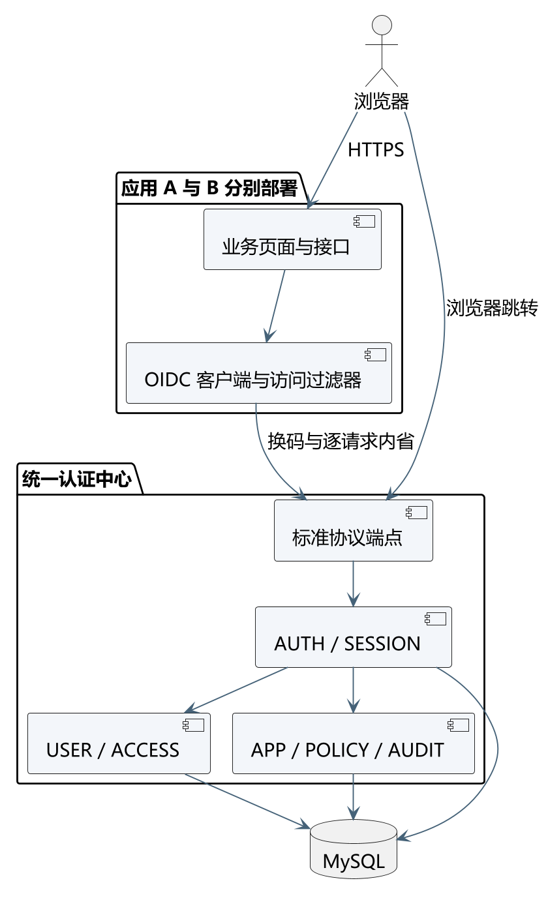
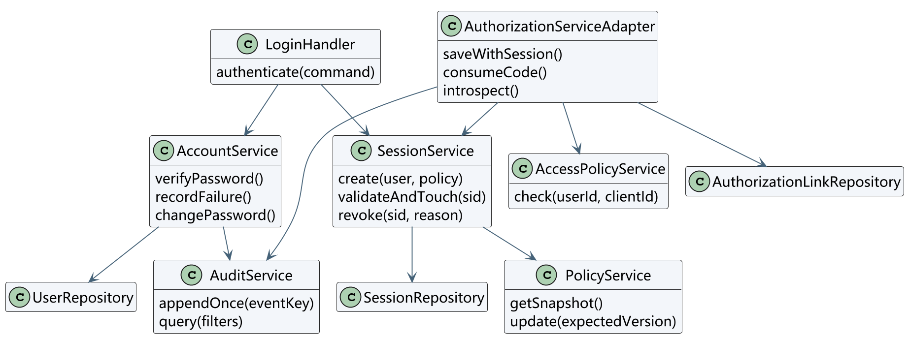
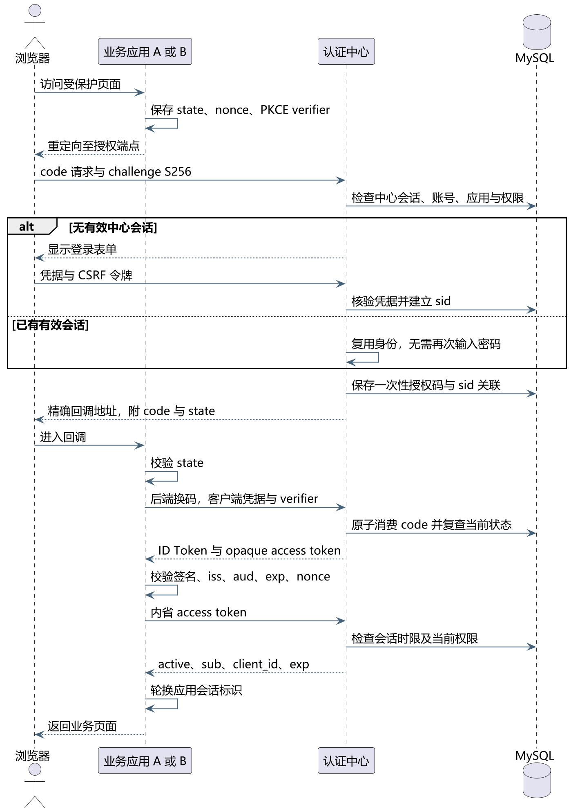
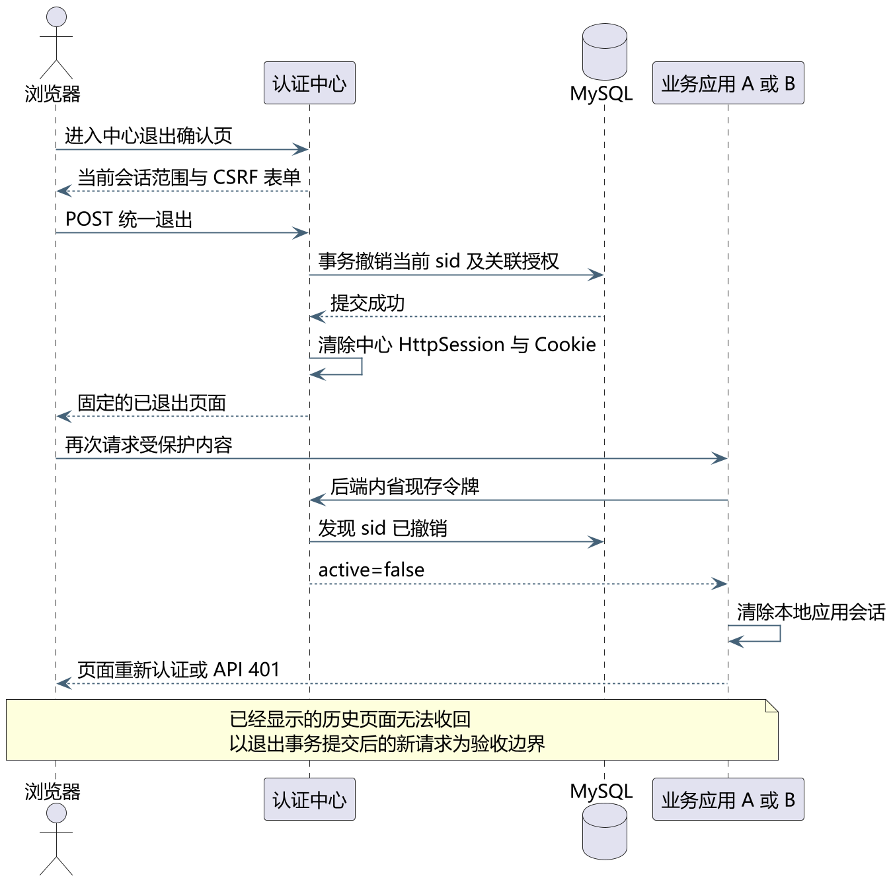
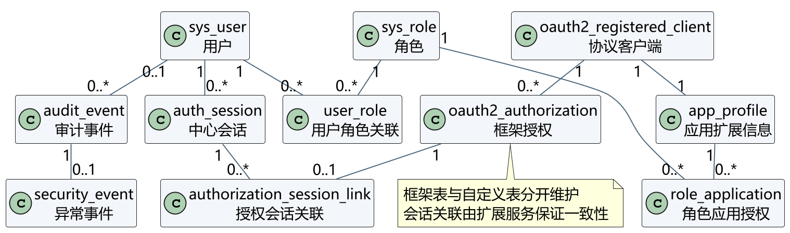
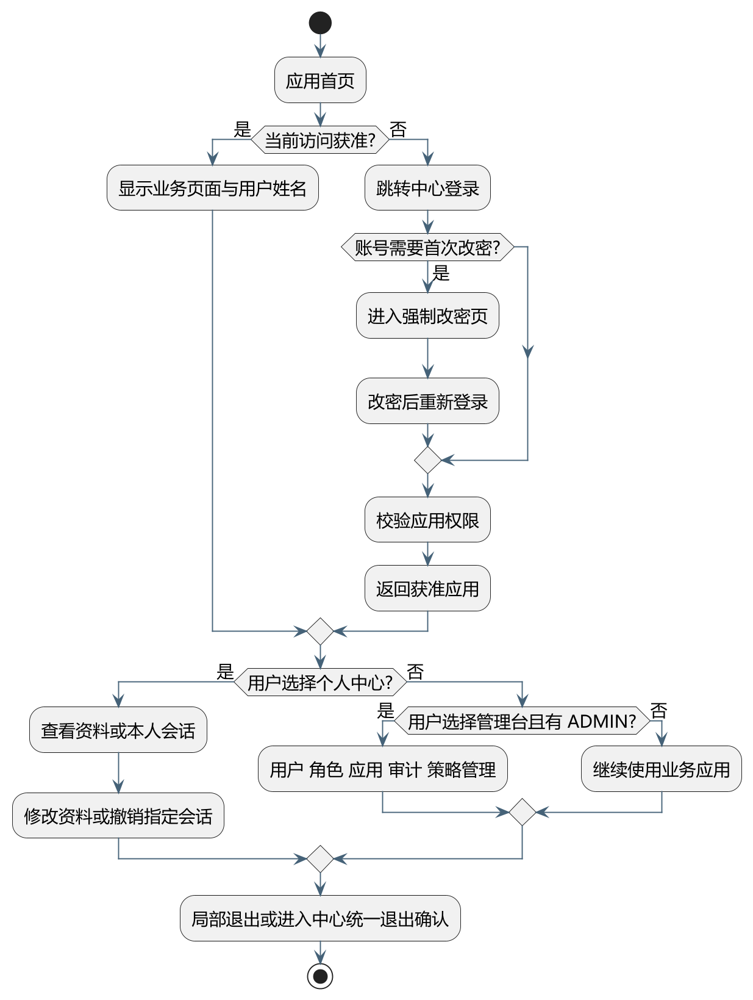

# 统一认证登录软件概要与详细设计说明书

版本：V0.9（第 3 周预研稿，第 4～5 周定稿并提交团队评审）  
项目成员：李鹏、汪泽洋、文泰龙  
编制日期：2026 年 10 月 22 日　计划基线日期：2026 年 11 月 11 日

本文把《软件需求规格说明书》中的 18 项功能落实为可编码的架构、模块、数据、接口和处理规则。设计结论是：采用三个独立 Web 服务模拟统一认证中心、教务信息服务 A 和图书信息服务 B；认证中心使用 OIDC 授权码流程与 PKCE S256；业务应用使用后端会话保存令牌，并在每次受保护访问时调用令牌内省以获得撤权后的下一请求失效能力。本文是设计基线草案，不代表软件已经实现或完成测试。

## 1 引言

### 1.1 编写目的

本文供三名成员在第 6 周开始编码时共同使用，也供课程检查时说明需求如何转化为设计。概要设计说明服务边界和模块职责；详细设计规定数据字段、接口、状态变化、异常处理和安全约束。未在本文中明确的实现细节，应先回到需求编号确认，再通过版本记录补充，不能由单个成员临时改变跨模块规则。

### 1.2 范围与边界

系统提供一套账号在 A、B 两个独立业务系统之间登录、单点认证、授权和退出。A 与 B 只实现用于验证统一认证的简单页面及受保护接口，不扩展教务或图书业务。课程范围包含账号、会话、角色、接入应用、审计、统计、安全策略和异常事件管理。社交登录、多因素认证、集群高可用、跨组织身份联合和移动端原生应用不进入本阶段。

### 1.3 设计依据

- 课程设计要求第 5、6、11、12 页中的计划、需求和设计文档要求。
- 《03 软件需求规格说明书》，功能编号 F01 至 F18。
- OpenID Connect Core 1.0：https://openid.net/specs/openid-connect-core-1_0.html
- OAuth 2.0 Token Introspection：https://www.rfc-editor.org/info/rfc7662/
- Spring Authorization Server 参考文档：https://docs.spring.io/spring-authorization-server/reference/overview.html

### 1.4 术语

| 术语 | 含义 |
| --- | --- |
| 认证中心 | 集中维护账号、中心会话、协议授权和全局管理数据的服务 |
| 业务应用 | 教务信息服务 A 或图书信息服务 B，分别作为独立 OIDC 客户端 |
| 中心会话 sid | 某一浏览器在认证中心的登录会话标识，与其他浏览器会话相互独立 |
| 应用会话 | A 或 B 自己建立的后端 HttpSession，不等同于中心会话 |
| 应用授权 | 框架授权记录及访问令牌，与中心 sid 建立显式关联 |
| 局部退出 | 只结束当前业务应用的会话和对应授权，中心会话保留 |
| 统一退出 | 撤销当前中心 sid 及其关联的全部应用授权 |

## 2 任务与运行概述

### 2.1 参与者与职责

| 成员 | 设计负责范围 | 对应功能 |
| --- | --- | --- |
| 李鹏 | 登录、协议接入、会话和退出 | F01 至 F06 |
| 汪泽洋 | 账号、注册审核、密码、登录限制和角色 | F07 至 F12 |
| 文泰龙 | 接入应用、应用授权、审计统计、策略和异常事件 | F13 至 F18 |

跨模块修改由三人共同检查接口、表结构和追踪矩阵。上述分工用于确定主责，不免除成员对集成结果的责任。

### 2.2 技术基线

| 层次 | 计划技术 | 选择理由与限制 |
| --- | --- | --- |
| 语言 | Java 21 | 长期支持版本，适合课程环境；第 6 周确认实际安装版本 |
| Web 框架 | Spring Boot 3.5.x、Spring MVC、Thymeleaf | 页面简单，使用服务端渲染可减少前端工程量 |
| 安全框架 | Spring Security 6.5.x、Spring Authorization Server 1.5.x | 使用成熟协议实现，扩展自定义会话关联与实时授权检查 |
| 协议 | OIDC 授权码流程、PKCE S256 | 应用后端换码，避免浏览器直接保存访问令牌 |
| 数据库 | MySQL 8.4 | 支持事务、外键、唯一约束和常用索引 |
| 构建 | Maven | 统一依赖和构建步骤 |

表中的次版本是设计兼容线，不表示已经安装或通过运行验证。第 6 周开始编码时锁定补丁版本并记录到依赖清单，数据库框架表必须采用该版本的官方脚本。

### 2.3 计划部署

本地演示使用同一主机的三个端口：认证中心 127.0.0.1:9000、应用 A 127.0.0.1:8081、应用 B 127.0.0.1:8082，演示环境使用 HTTP，属隔离网络内的本地运行，不作为 NFR01 的验收证据；需要 HTTPS 时以 https profile 启动，域名与证书另行配置。由于浏览器 Cookie 不按端口隔离，三个服务必须使用互不相同的 Cookie 名称（SESSION_CENTER、SESSION_A、SESSION_B），Cookie 设置 HttpOnly 与 SameSite=Lax，启用 HTTPS 时再加 Secure。认证中心连接 MySQL；A 与 B 可以使用各自的内存业务数据，但认证和授权必须来自中心。

## 3 总体架构设计

### 3.1 服务与信任边界

浏览器是非可信输入端。业务应用负责保存授权请求上下文、验证认证结果并保护业务资源；认证中心是身份和全局授权的唯一可信来源；数据库保存持久身份及授权状态。A 与 B 不共享应用 HttpSession，也不直接读取彼此数据库。业务应用只能通过后端协议端点换码和内省，不把客户端密钥或完整令牌放入浏览器脚本。

### 3.2 分层结构

| 层 | 主要职责 | 允许依赖 |
| --- | --- | --- |
| Web 与协议层 | 页面、表单校验、OIDC 端点、REST 契约、错误转换 | 应用服务层 |
| 应用服务层 | 登录、会话、账号、授权、审计等用例编排和事务边界 | 领域规则与仓储接口 |
| 领域规则层 | 状态机、策略校验、授权判定、撤销范围 | 无 Web 框架对象 |
| 持久化层 | JPA 或 JDBC 映射、锁与版本检查、框架表适配 | MySQL |

### 3.3 包与程序单元

| 程序包 | 主要类或组件 | 功能编号 |
| --- | --- | --- |
| cn.edu.sso.auth | LoginHandler、OidcExtensionService、CredentialAuthenticationProvider | F01 至 F03 |
| cn.edu.sso.session | SessionService、SessionRepository、LogoutController | F04 至 F06 |
| cn.edu.sso.user | UserService、RegistrationService、PasswordService | F07 至 F11 |
| cn.edu.sso.access | RoleService、AccessPolicyService | F12、F14 |
| cn.edu.sso.app | ApplicationService、ClientProfileRepository | F13 |
| cn.edu.sso.audit | AuditService、StatisticsService、SecurityEventService | F15、F16、F18 |
| cn.edu.sso.policy | PolicyService、PolicySnapshot | F17 |
| cn.edu.sso.common | requestId、统一错误、时间与脱敏工具 | 全部 |

## 4 模块详细设计

### 4.1 AUTH 登录与协议模块

AUTH 负责凭据认证、OIDC 授权请求和协议结果。应用使用 confidential client，授权方法为 authorization_code，PKCE 方法固定 S256。授权码有效期 60 秒且只能原子消费一次；不透明 access token 有效期 10 分钟；本课程范围不签发 refresh token。令牌过期后，应用重新发起授权；如果中心会话仍有效，用户无需再次输入密码。

认证处理步骤如下：

1. 应用在自己的 HttpSession 中产生并保存 state、nonce 和 PKCE verifier，仅把 challenge 发送给中心。
2. 中心精确校验 client_id、response_type、scope 和 redirect_uri；回调地址不允许通配符、片段或非 HTTPS 地址。
3. 中心先检查 sid 的状态、空闲时限和绝对时限。无有效会话时显示登录表单；有有效会话时复用身份。
4. 凭据认证同时检查账号状态、锁定截止时间和 must_change_password。不存在的账号与错误密码使用相同对外提示。
5. 授权前检查当前用户有效角色与 role_application 的交集；无匹配关系时默认拒绝。
6. 中心保存授权码与 sid 的关联，然后只向登记的 redirect_uri 返回 code 和 state。
7. 应用校验 state，后端携带客户端凭据和 verifier 换码。中心原子消费 code，并再次检查用户、应用、权限和 sid 状态。
8. 应用校验 ID Token 的签名、iss、aud、exp 和 nonce，随后建立或轮换本地应用会话标识。

### 4.2 SESSION 会话模块

中心 HttpSession 保存少量运行态数据，auth_session 保存可管理的会话元数据。创建会话时把安全策略版本、空闲秒数和绝对秒数写成快照。每次中心交互调用 validateAndTouch：若 now 大于或等于 last_active_at 加空闲时限，或大于或等于 created_at 加绝对时限，则在事务中把状态设为 EXPIRED 并撤销关联授权；否则更新 last_active_at。刷新活动时间不能延长绝对截止时间。

状态只允许 ACTIVE 转为 EXPIRED 或 REVOKED，两个终止状态不能恢复。再次登录创建新 sid。认证中心重启且内存 HttpSession 丢失时，启动恢复过程把无法对应的旧 ACTIVE 会话按 REVOKED 处理，避免数据库记录看似有效而运行态已经丢失。

撤销范围如下：

| 触发 | 撤销范围 | 后续行为 |
| --- | --- | --- |
| 局部退出 | 当前 A 或 B 的应用会话及对应授权 | 中心 sid 保留，再入应用可单点认证 |
| 统一退出 | 当前浏览器 sid 与所有关联授权 | A、B 的下一次受保护请求重新认证 |
| 用户结束指定会话 | 指定 sid 与关联授权 | 其他 sid 不受影响 |
| 修改或重置密码 | 用户全部 sid 与关联授权，auth_version 加一 | 使用新密码重新登录 |
| 停用用户 | 用户全部 sid 与关联授权 | 状态恢复前不能登录 |
| 停用应用 | 该 client 的全部授权 | 不能发起或继续该应用授权 |

### 4.3 USER 账号与安全模块

用户名保存为小写，必须匹配 `[a-z][a-z0-9_]{3,31}` 并设置唯一索引。密码接受 12 至 64 个 Unicode 字符，必须同时包含字母和数字，允许空格和特殊字符，不做静默截断。设计使用 Spring Argon2PasswordEncoder 的成熟实现；具体内存、迭代与并行参数在第 6 周按演示机资源确定并记录，不自行实现散列算法。

注册创建 PENDING 用户；批准变为 ACTIVE 并授予 USER 基础角色；拒绝变为 REJECTED 且用户名继续占用。用户停用使用 DISABLED，不物理删除存在审计关系的账号。管理员重置密码后设置 must_change_password=true，只允许用户进入改密和退出操作。

登录失败处理在用户行上使用行锁或等价串行化事务。新失败窗口保存当时策略快照。15 分钟默认窗口内第 5 次失败设置 locked_until=当前时间+15 分钟并产生唯一异常事件；成功登录、锁定到期或人工解锁清零窗口。修改策略不缩短已经形成的锁定期限。关闭异常事件不会自动解锁账号。

### 4.4 ACCESS 与 APP 模块

角色通过 user_role 赋给用户，通过 role_application 获得应用访问权。授权条件为：用户 ACTIVE 且未锁定、应用 ENABLED、至少一个有效角色与目标应用存在关系、sid ACTIVE 且 auth_version 与授权快照一致。管理员管理权限不自动获得所有业务应用权限。系统 ADMIN 角色不可删除，并禁止停用或降权最后一个有效管理员。

接入应用由协议客户端表和 app_profile 一对一组成。创建客户端时生成的密钥只显示一次，数据库只保存框架支持的安全编码值。回调地址以集合方式精确匹配，不接受通配符和 URL fragment。应用停用后不签发新授权，并撤销该应用现存授权。

### 4.5 AUDIT、POLICY 与异常事件模块

AuditService 在关键事务成功或失败处写入审计。event_key 设置唯一索引以避免重试重复写入。审计只记录事件类型、结果、操作者摘要、应用、requestId、脱敏来源和安全细节；禁止记录密码、完整令牌和客户端密钥。凭据登录成功或失败、SSO 授权、应用进入和内省是不同事件，统计时不能把每次内省计作登录。

统计查询按 `[start,end)` 左闭右开区间，数据库使用 UTC，页面转换为 Asia/Shanghai。应用使用量定义为成功授权或成功进入应用，不等于页面刷新次数。审计单页最多 100 条，查询跨度最多 90 天。

security_policy 是单例版本化记录。空闲时限范围 5 至 120 分钟，绝对时限 1 至 24 小时，且空闲不大于绝对时限；失败窗口 5 至 60 分钟，阈值 3 至 10 次，锁定时长 5 至 60 分钟。更新携带期望版本号，冲突返回 409。新会话和新的失败窗口使用新策略，已有快照保持不变。

异常事件只由达到锁定阈值等明确安全触发产生。状态按 OPEN、ACKNOWLEDGED、CLOSED 单向变化；关闭必须填写原因并保留处理人和时间。

## 5 数据设计

### 5.1 数据关系与约定

所有主键使用 BIGINT 自增或由框架规定的 VARCHAR 标识；所有时间使用 DATETIME(6) 并按 UTC 保存；逻辑状态使用受代码枚举和数据库检查共同约束的 VARCHAR。业务表采用 InnoDB 和 utf8mb4。外键列建立索引，关联表使用组合主键，频繁筛选字段建立复合索引。

### 5.2 sys_user 用户表

| 字段 | 类型 | 空值与默认 | 键和约束 | 说明 |
| --- | --- | --- | --- | --- |
| id | BIGINT | 非空 | PK | 用户标识 |
| username | VARCHAR(32) | 非空 | UK，格式约束 | 小写登录名 |
| password_hash | VARCHAR(255) | 非空 | 仅安全散列 | 禁止日志输出 |
| display_name | VARCHAR(64) | 非空 |  | 显示名 |
| email | VARCHAR(254) | 可空 | 合法邮箱格式 | 联系邮箱 |
| status | VARCHAR(16) | 非空 | PENDING/ACTIVE/REJECTED/DISABLED | 账号状态 |
| must_change_password | BOOLEAN | false |  | 是否强制改密 |
| auth_version | BIGINT | 0 | 非负 | 改密、停用时递增 |
| failed_count | INT | 0 | 非负 | 当前失败窗口计数 |
| failed_window_start | DATETIME(6) | 可空 |  | 窗口开始 UTC |
| failed_policy_version | BIGINT | 可空 |  | 失败策略快照版本 |
| failed_window_seconds | INT | 可空 | 正范围 | 快照窗口秒数 |
| failed_threshold | INT | 可空 | 正范围 | 快照阈值 |
| failed_lock_seconds | INT | 可空 | 正范围 | 快照锁定秒数 |
| locked_until | DATETIME(6) | 可空 |  | 临时锁定截止时间 |
| reviewed_by | BIGINT | 可空 | FK sys_user.id | 审核人 |
| reviewed_at | DATETIME(6) | 可空 |  | 审核时间 |
| review_comment | VARCHAR(500) | 可空 |  | 审核说明 |
| created_at/updated_at | DATETIME(6) | 非空 |  | 创建和修改时间 |
| version | BIGINT | 0 | 乐观锁 | 并发更新版本 |

索引：uk_user_username(username)；idx_user_status(status)；idx_user_lock(locked_until)。

### 5.3 角色与应用授权表

| 表与字段 | 类型 | 空值与默认 | 键和约束 | 说明 |
| --- | --- | --- | --- | --- |
| sys_role.id | BIGINT | 非空 | PK | 角色标识 |
| sys_role.code | VARCHAR(32) | 非空 | UK，大写编码 | ADMIN、USER 等 |
| sys_role.name | VARCHAR(64) | 非空 |  | 角色名称 |
| sys_role.enabled | BOOLEAN | true |  | 是否参与授权 |
| sys_role.system_role | BOOLEAN | false | ADMIN 为 true | 系统角色保护标志 |
| user_role.user_id | BIGINT | 非空 | PK、FK sys_user | 用户 |
| user_role.role_id | BIGINT | 非空 | PK、FK sys_role | 角色 |
| role_application.role_id | BIGINT | 非空 | PK、FK sys_role | 角色 |
| role_application.application_id | BIGINT | 非空 | PK、FK app_profile | 应用 |

删除用户、角色或应用前必须检查业务保护规则；关联表组合主键天然防止重复分配。

### 5.4 app_profile 应用扩展表

| 字段 | 类型 | 空值与默认 | 键和约束 | 说明 |
| --- | --- | --- | --- | --- |
| id | BIGINT | 非空 | PK | 应用标识 |
| registered_client_id | VARCHAR(100) | 非空 | UK、FK 框架客户端表 | 协议客户端记录 |
| app_code | VARCHAR(32) | 非空 | UK | APP_A、APP_B |
| display_name | VARCHAR(100) | 非空 |  | 页面名称 |
| status | VARCHAR(16) | ENABLED | ENABLED/DISABLED | 应用状态 |
| description | VARCHAR(500) | 可空 |  | 应用说明 |
| created_by/updated_by | BIGINT | 非空 | FK sys_user | 操作人 |
| created_at/updated_at | DATETIME(6) | 非空 |  | 时间 |
| version | BIGINT | 0 | 乐观锁 | 并发版本 |

回调地址、grant type、scope、客户端认证方式和客户端密钥由 oauth2_registered_client 按固定框架版本保存，应用服务负责额外的 HTTPS、精确地址和无 fragment 校验。

### 5.5 auth_session 中心会话表

| 字段 | 类型 | 空值与默认 | 键和约束 | 说明 |
| --- | --- | --- | --- | --- |
| sid | VARCHAR(64) | 非空 | PK，不可预测 | 对外会话标识 |
| user_id | BIGINT | 非空 | FK sys_user | 所属用户 |
| http_session_digest | CHAR(64) | 非空 | UK | 运行会话标识的摘要 |
| created_at | DATETIME(6) | 非空 |  | 创建 UTC |
| last_active_at | DATETIME(6) | 非空 | 不早于创建时间 | 最近活动 UTC |
| absolute_expires_at | DATETIME(6) | 非空 | 晚于创建时间 | 绝对截止时间 |
| idle_timeout_seconds | INT | 非空 | 300 至 7200 | 空闲快照 |
| status | VARCHAR(16) | ACTIVE | ACTIVE/EXPIRED/REVOKED | 会话状态 |
| revoked_at | DATETIME(6) | 可空 | 终止时填写 | 撤销时间 |
| revoke_reason | VARCHAR(64) | 可空 |  | 撤销原因编码 |
| device_summary | VARCHAR(200) | 非空 | 已脱敏 | 浏览器和来源摘要 |
| policy_version | BIGINT | 非空 |  | 创建时策略版本 |
| user_auth_version | BIGINT | 非空 |  | 创建时用户认证版本 |

索引：idx_session_user_status(user_id,status)；idx_session_absolute(status,absolute_expires_at)；idx_session_last_active(status,last_active_at)。

### 5.6 authorization_session_link 授权会话关联表

| 字段 | 类型 | 空值与默认 | 键和约束 | 说明 |
| --- | --- | --- | --- | --- |
| authorization_id | VARCHAR(100) | 非空 | PK、FK oauth2_authorization.id | 框架授权 |
| sid | VARCHAR(64) | 非空 | FK auth_session.sid | 中心会话 |
| registered_client_id | VARCHAR(100) | 非空 | FK 客户端表 | 目标客户端 |
| user_auth_version | BIGINT | 非空 |  | 授权时版本快照 |
| created_at | DATETIME(6) | 非空 |  | 关联时间 |
| revoked_at | DATETIME(6) | 可空 |  | 撤销时间 |

索引：idx_link_sid_active(sid,revoked_at)；idx_link_client_active(registered_client_id,revoked_at)。授权创建、关联创建和审计写入处于同一应用事务；撤销先锁定关联行，再使框架授权失效。

### 5.7 security_policy 策略表

| 字段 | 类型 | 空值与默认 | 键和约束 | 说明 |
| --- | --- | --- | --- | --- |
| id | BIGINT | 固定为 1 | PK、CHECK id=1 | 单例策略 |
| idle_timeout_minutes | INT | 30 | 5 至 120 | 空闲时限 |
| absolute_timeout_hours | INT | 8 | 1 至 24 | 绝对时限 |
| failure_window_minutes | INT | 15 | 5 至 60 | 失败窗口 |
| failure_threshold | INT | 5 | 3 至 10 | 锁定阈值 |
| lock_minutes | INT | 15 | 5 至 60 | 锁定时长 |
| updated_by | BIGINT | 非空 | FK sys_user | 操作人 |
| updated_at | DATETIME(6) | 非空 |  | 修改时间 |
| version | BIGINT | 0 | 乐观锁 | 策略版本 |

服务层额外校验 idle_timeout_minutes 不大于 absolute_timeout_hours×60。

### 5.8 审计与异常事件表

| 字段 | 类型 | 空值与默认 | 键和约束 | 说明 |
| --- | --- | --- | --- | --- |
| audit_event.id | BIGINT | 非空 | PK | 审计标识 |
| audit_event.event_key | VARCHAR(100) | 非空 | UK | 幂等键 |
| audit_event.actor_user_id | BIGINT | 可空 | FK sys_user | 操作者或目标用户 |
| audit_event.application_id | BIGINT | 可空 | FK app_profile | 关联应用 |
| audit_event.event_type | VARCHAR(48) | 非空 | 枚举 | 事件类型 |
| audit_event.result | VARCHAR(16) | 非空 | SUCCESS/FAILURE | 结果 |
| audit_event.occurred_at | DATETIME(6) | 非空 |  | UTC 时间 |
| audit_event.request_id | VARCHAR(64) | 非空 | 索引 | 请求标识 |
| audit_event.source_masked | VARCHAR(100) | 可空 | 已脱敏 | 来源摘要 |
| audit_event.detail_json | JSON | 可空 | 安全字段白名单 | 事件详情 |
| security_event.id | BIGINT | 非空 | PK | 异常事件标识 |
| security_event.source_audit_id | BIGINT | 非空 | UK、FK audit_event | 来源审计 |
| security_event.status | VARCHAR(16) | OPEN | OPEN/ACKNOWLEDGED/CLOSED | 状态 |
| security_event.assigned_to | BIGINT | 可空 | FK sys_user | 处理人 |
| security_event.ack_at/closed_at | DATETIME(6) | 可空 | 状态对应 | 确认及关闭时间 |
| security_event.close_reason | VARCHAR(500) | 可空 | CLOSED 时非空 | 关闭原因 |
| security_event.version | BIGINT | 0 | 乐观锁 | 并发版本 |

索引：idx_audit_query(occurred_at,event_type,result)；idx_audit_user(actor_user_id,occurred_at)；idx_security_status(status,created_at)。

### 5.9 框架协议表

oauth2_registered_client 保存 client_id、客户端密钥、认证方法、授权类型、回调地址、scope 和 token 设置；oauth2_authorization 保存授权码、ID Token、不透明访问令牌及其元数据；oauth2_authorization_consent 保存用户同意。字段长度和序列化格式严格采用第 6 周锁定的 Spring Authorization Server 官方 JDBC 脚本，不手工删减。数据库账号使用最小权限，备份文件按敏感数据保护。

## 6 接口设计

### 6.1 通用约定

页面表单使用 UTF-8、HTTPS、CSRF 令牌和服务器端字段校验；JSON 接口的 Content-Type 为 application/json。时间采用 ISO 8601 UTC 输出，页面显示北京时间。成功列表返回 items、page、size、total；错误返回 code、message、requestId 和 fieldErrors，不返回堆栈或敏感值。写操作支持版本字段时必须携带 version。

### 6.2 协议与会话接口

| 接口 ID | 方法与路径 | 权限 | 主要输入与输出 | 主要错误 | 需求 |
| --- | --- | --- | --- | --- | --- |
| I-AUTH-01 | GET /oauth2/authorize | 已登记客户端 | client_id、redirect_uri、state、nonce、challenge；返回登录页或 code | invalid_request、access_denied | F01、F02 |
| I-AUTH-02 | POST /login | 匿名加 CSRF | username、password；建立 sid 并继续授权 | 凭据统一错误、锁定 | F01、F11 |
| I-AUTH-03 | POST /oauth2/token | 客户端认证 | code、verifier、redirect_uri；返回 ID Token 与 access token | invalid_grant | F02 |
| I-AUTH-04 | POST /oauth2/introspect | 客户端认证 | token；返回 active、sub、client_id、exp | 401、active=false | F03、F05 |
| I-SESSION-01 | GET /api/me/sessions | 登录用户 | 本人的会话摘要列表 | 401 | F06 |
| I-SESSION-02 | DELETE /api/me/sessions/{sid} | 会话所有者 | 撤销指定 sid，重复调用仍成功 | 403 | F06 |
| I-SESSION-03 | POST /logout | 登录用户加 CSRF | 撤销当前 sid 与关联授权 | 400 | F04 |

### 6.3 用户与权限接口

| 接口 ID | 方法与路径 | 权限 | 主要输入与输出 | 主要错误 | 需求 |
| --- | --- | --- | --- | --- | --- |
| I-USER-01 | POST /api/register | 匿名加限速 | 注册字段；返回申请编号和 PENDING | 409 用户名冲突、422 | F08 |
| I-USER-02 | GET/PUT /api/me/profile | 登录用户 | 显示名、邮箱、version | 409、422 | F09 |
| I-USER-03 | POST /api/me/password | 登录用户 | oldPassword、newPassword；撤销全部会话 | 400、422 | F10 |
| I-ADMIN-USER-01 | GET/POST/PUT /api/admin/users | ADMIN | 用户筛选及创建修改 | 403、409、422 | F07 |
| I-ADMIN-USER-02 | POST /api/admin/users/{id}/review | ADMIN | APPROVE/REJECT、comment、version | 409 | F08 |
| I-ADMIN-USER-03 | POST /api/admin/users/{id}/reset-password | ADMIN | 一次性密码只在响应显示 | 403、409 | F10 |
| I-ADMIN-USER-04 | POST /api/admin/users/{id}/unlock | ADMIN | 清零失败窗口 | 403、409 | F11 |
| I-ROLE-01 | GET/POST/PUT /api/admin/roles | ADMIN | 角色字段、version | 409、422 | F12 |
| I-ROLE-02 | PUT /api/admin/users/{id}/roles | ADMIN | roleIds、version | 最后管理员保护 | F12 |
| I-ACCESS-01 | PUT /api/admin/roles/{id}/applications | ADMIN | applicationIds、version | 409 | F14 |

### 6.4 应用、审计与策略接口

| 接口 ID | 方法与路径 | 权限 | 主要输入与输出 | 主要错误 | 需求 |
| --- | --- | --- | --- | --- | --- |
| I-APP-01 | GET/POST/PUT /api/admin/applications | ADMIN | client、回调集合、状态、version | 409、422 | F13 |
| I-AUDIT-01 | GET /api/admin/audits | ADMIN | 时间、类型、用户、应用、结果、分页 | 跨度或页大小 422 | F15 |
| I-AUDIT-02 | GET /api/admin/statistics | ADMIN | [start,end)、应用、分组；返回计数 | 422 | F16 |
| I-POLICY-01 | GET/PUT /api/admin/policies/security | ADMIN | 策略字段、version | 409、422 | F17 |
| I-EVENT-01 | GET /api/admin/security-events | ADMIN | 状态、时间、分页 | 422 | F18 |
| I-EVENT-02 | POST /api/admin/security-events/{id}/ack | ADMIN | version | 409 | F18 |
| I-EVENT-03 | POST /api/admin/security-events/{id}/close | ADMIN | reason、version | 409、422 | F18 |

### 6.5 HTTP 与业务错误

| 状态 | 使用场景 | 页面行为 |
| --- | --- | --- |
| 400 | 协议参数缺失、CSRF 失败或非法状态变化 | 显示安全的通用错误页 |
| 401 | API 未认证或应用令牌 inactive | 清除应用会话并发起认证 |
| 403 | 已认证但没有应用或管理权限 | 显示拒绝原因摘要，不泄露数据 |
| 404 | 对当前用户不可见的资源不存在 | 使用统一不存在响应 |
| 409 | 乐观锁冲突、重复用户名或重复客户端 | 提示刷新后重试 |
| 422 | 字段格式、策略范围、时间跨度不合法 | 返回字段级错误 |
| 429 | 匿名注册或不存在账号来源尝试过频 | 稍后重试 |
| 503 | 认证中心或关键数据库不可用 | 业务应用拒绝提供受保护数据 |

## 7 界面设计

界面使用统一的顶部项目名称、当前用户、返回应用和退出入口。表单按字段显示校验错误，不在登录页区分账号不存在、密码错误、待审核或停用等内部原因。管理列表采用服务器端分页，不提供大批量导出敏感数据。

| 页面 ID | 页面 | 主要元素与操作 | 访问者 |
| --- | --- | --- | --- |
| P01 | 中心登录 | 用户名、密码、登录、注册链接、通用错误 | 匿名用户 |
| P02 | 注册 | 用户名、密码、确认密码、显示名、邮箱 | 申请者 |
| P03 | 强制改密 | 一次性密码、新密码、确认、退出 | must_change_password 用户 |
| P04 | 个人中心 | 资料、改密、本人会话列表及结束按钮 | 普通用户 |
| P05 | 统一退出确认 | 当前会话范围、确认退出、取消返回 | 登录用户 |
| P06 | 管理首页 | 待审核、开放异常和近期认证摘要 | ADMIN |
| P07 | 用户与角色 | 用户筛选、审核、停用、解锁、重置、角色分配 | ADMIN |
| P08 | 应用与授权 | 客户端信息、回调地址、状态、角色授权 | ADMIN |
| P09 | 审计与统计 | 条件、分页日志、按日或应用统计 | ADMIN |
| P10 | 策略与异常 | 策略版本表单、异常状态处理、关闭原因 | ADMIN |
| P11 | A 或 B 业务首页 | 当前用户、受保护数据、局部退出、统一退出入口 | 获授权用户 |

## 8 关键事务与伪代码

### 8.1 受保护访问

1. 应用从后端会话取得 access token；没有则发起认证。
2. 应用调用内省端点，不使用正向 active 缓存。
3. 中心锁定或读取关联会话，检查 sid 状态、两类时限、用户状态、auth_version、应用状态和实时角色应用关系。
4. 任一检查失败返回 active=false；成功时更新会话活动时间并返回最少必要声明。
5. 应用收到 inactive 清除本地会话；页面请求重新认证，API 返回 401。

### 8.2 统一撤销

在一个事务中锁定 auth_session，若已终止则幂等返回；否则设置 REVOKED 和 revoked_at，查询未撤销的 authorization_session_link，逐项使框架授权失效并写 revoked_at，最后使用唯一 event_key 写入审计。事务提交后再清除当前中心 HttpSession 和 Cookie。

### 8.3 最后管理员保护

停用用户或移除 ADMIN 前，以锁定方式统计仍为 ACTIVE 且拥有 ADMIN 的用户数量。若目标是其中之一且数量为 1，则返回 409；否则执行修改、递增版本并写审计。该检查与修改必须处于同一事务。

### 8.4 策略更新

校验每个范围及 idle<=absolute；使用 `WHERE id=1 AND version=:expected` 更新并令 version+1；影响行数为 0 时返回 409。更新只影响此后创建的会话和新失败窗口，不遍历修改已有快照或锁定截止时间。

## 9 安全设计

- 所有外部入口使用 HTTPS；生产式配置禁止明文 HTTP 回调。
- 登录、退出和管理写操作使用 CSRF 防护；协议端使用 state、nonce 和 PKCE S256。
- 登录后、提权后及认证回调成功后轮换应用会话标识，防止会话固定。
- 密码只保存 Argon2id 散列；客户端密钥、令牌和一次性密码不进入日志。
- Cookie 设置 HttpOnly、Secure、SameSite=Lax 和主机限定，不设置跨子域 Domain。
- 管理页面每次请求复查当前账号状态与 ADMIN 角色；页面隐藏不能替代后端授权。
- 错误页面不显示堆栈、数据库语句或账号存在性；审计来源和设备信息先脱敏。
- 数据库账号只授予所需表权限；备份加访问控制并定期验证恢复步骤。

## 10 运行、异常与维护设计

课程演示采用单实例。中心会话运行态和 A、B 应用会话可保存在各进程内存，持久会话元数据保存在 MySQL。应用重启会丢失本地会话并重新认证；中心重启按失效策略处理旧运行会话。该方案满足课程规模，但不作为集群高可用方案。

服务启动按数据库迁移、基础角色和策略检查、客户端配置检查、旧会话恢复处理的顺序进行。迁移脚本按版本只前进，不在运行时自动修改生产式表结构。每日备份数据库，至少进行一次人工恢复演练后才能声称备份可用。

统一 requestId 贯穿浏览器错误页、应用后端、中心日志和审计记录。认证中心不可用、数据库连接失败或内省超时时，业务应用 fail closed，返回 503 或安全错误页，不能使用过期的成功结果继续提供数据。

性能目标仍是待验证条件：4 核 8 GB、1000 个用户和两个应用的课程数据规模下，以 20 个并发用户验证核心认证和管理请求的 p95 不超过 2 秒。第 7 至 8 周运行测试前不能写成已达到。

## 11 需求到设计映射

| 功能 | 设计模块 | 主要表 | 主要接口或模型 |
| --- | --- | --- | --- |
| F01 至 F03 | AUTH、ACCESS | sys_user、auth_session、框架授权表 | I-AUTH-01 至 04、D02 |
| F04 至 F06 | SESSION | auth_session、authorization_session_link | I-SESSION-01 至 03、D05 |
| F07 至 F11 | USER | sys_user、audit_event、security_event | I-USER、I-ADMIN-USER |
| F12、F14 | ACCESS | sys_role、user_role、role_application | I-ROLE、I-ACCESS |
| F13 | APP | app_profile、oauth2_registered_client | I-APP-01 |
| F15、F16、F18 | AUDIT | audit_event、security_event | I-AUDIT、I-EVENT |
| F17 | POLICY | security_policy | I-POLICY-01 |

完整逐项关系见《05 需求设计测试追踪矩阵》。所有设计项进入编码前由三名成员实际评审并记录问题；当前 V0.9 状态只说明材料已准备，不表示评审已经发生。

## 12 第 5 周评审检查点

- 18 项功能均有模块、数据、接口或处理规则承接。
- OIDC、中心会话、应用会话和授权记录的边界已区分。
- 局部退出、统一退出、改密、账号停用和应用停用的范围一致。
- 数据字典包含类型、长度、空值、键、约束和关键索引。
- 接口包含权限、输入输出和错误语义，页面流程可支持演示。
- 性能、恢复和真实测试结果均保留为后续验证项。

以上检查点由团队在第 5 周评审时逐项确认并填写实际记录，确认后再把版本冻结为第 6 周编码基线。
