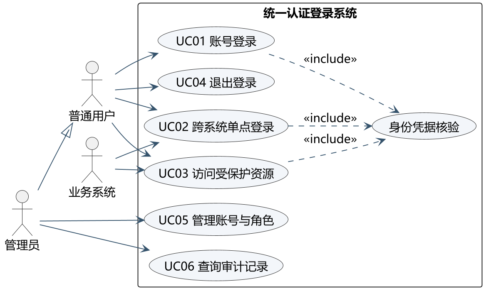
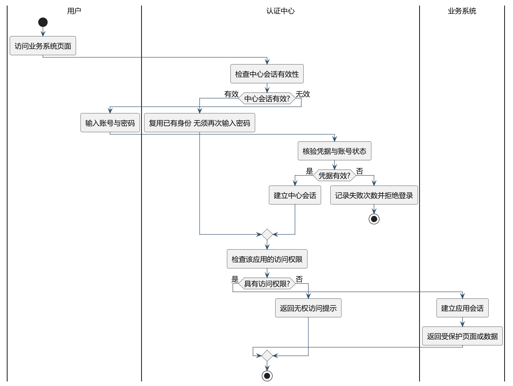
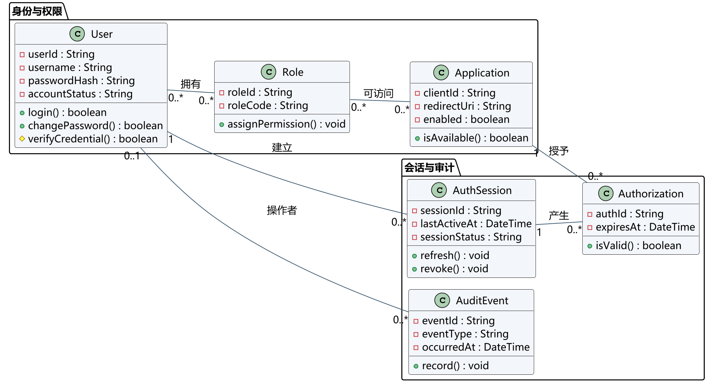
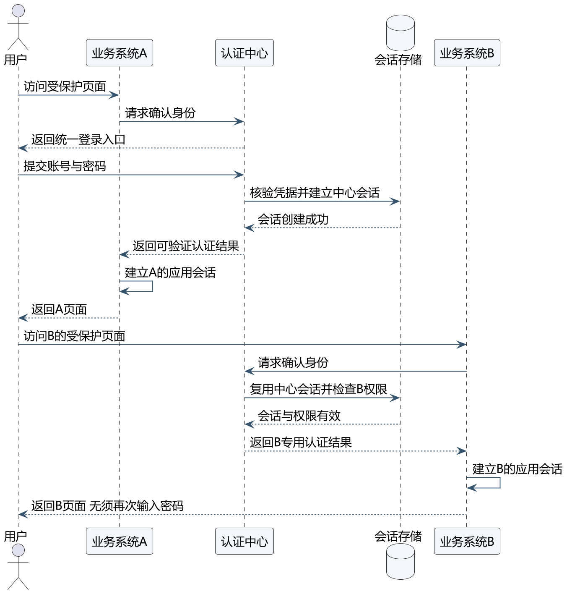
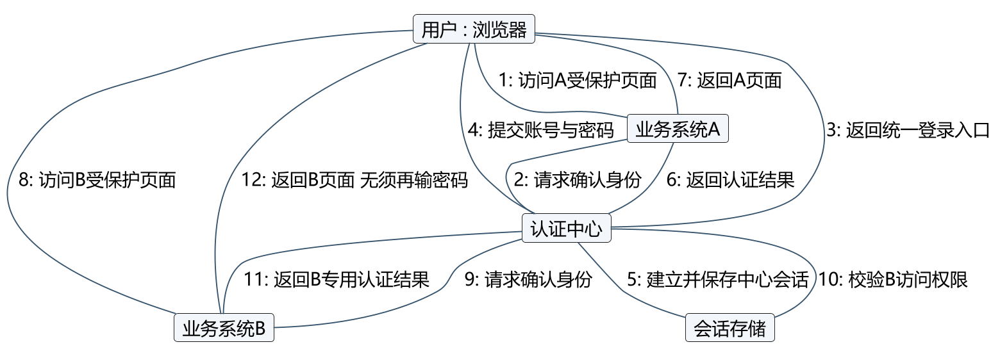
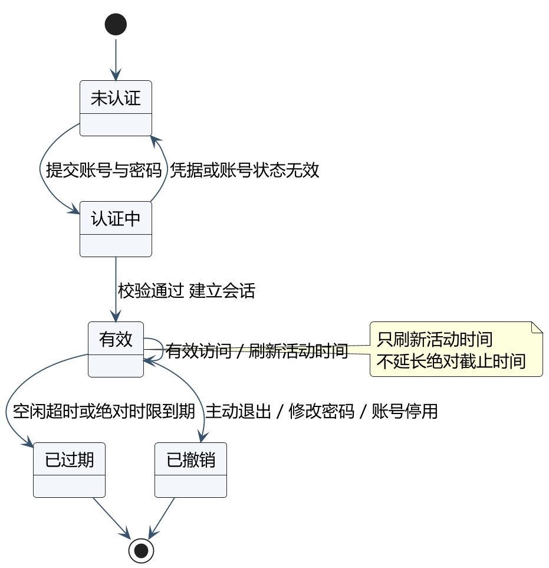
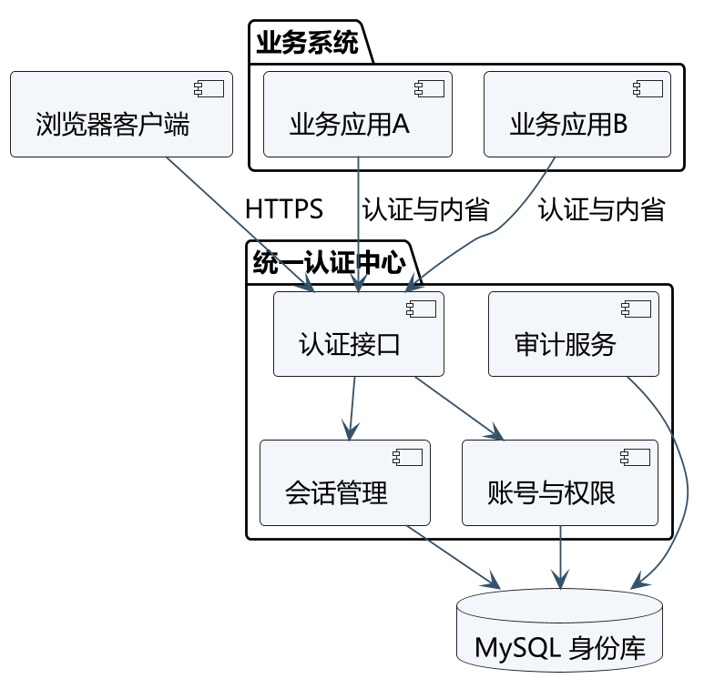
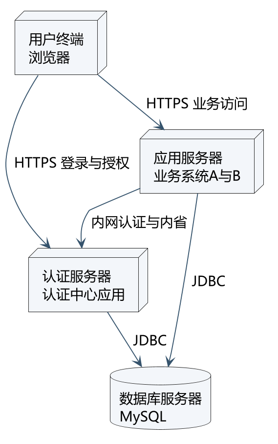

# 软件工程实验课 UML 绘图实验报告

课程：软件工程实验课（2026）　实验题目：了解和绘制 UML 图　日期：2026 年 10 月 15 日

姓名：李鹏　学号：2024141460031　指导教师：王疆寒

## 一、实验目的

掌握统一建模语言 UML 的基本概念与常用图元的表示法，理解 UML 五种视图与八类图形的用途和区别，能够针对同一软件系统分别从行为、结构和部署等角度建立模型。本实验按课件第三部分练习要求，绘制用例图、活动图、类图、序列图、协作图、状态图、构件图和部署图各一张。

## 二、实验环境与工具

| 项目 | 内容 |
| --- | --- |
| 绘图工具 | PlantUML 1.2025.4（文本化建模，源文件与成品图一并提交） |
| 运行环境 | Windows 11，Java SE 21.0.6，Microsoft YaHei 字体 |
| 导出格式 | 每张图导出 PNG 与 SVG，PNG 分辨率 180 dpi |
| 建模情景 | 本组课程设计题目「统一认证登录」，即一套账号跨平台使用与单点登录 |

说明：本实验的建模情景取自本组课程设计的实际题目，未另行虚构其他系统。所有图形由 PlantUML 文本源稿生成，源文件（.puml）随图一并提供，可二次编辑；本次未使用 Bouml 或 Rational Rose 等图形化工具。

## 三、实验内容与结果

课件练习要求对八类图各绘制一张，情景自拟。以下按用例图、活动图、类图、序列图、协作图、状态图、构件图、部署图的顺序给出结果，并说明每张图表达的内容与读图要点。

### 1 用例图

用例图从外部视角说明系统提供哪些功能、由谁使用。本图包含三个参与者：普通用户、管理员与业务系统，其中管理员通过泛化关系继承普通用户。系统边界内列出 UC01 账号登录、UC02 跨系统单点登录、UC03 访问受保护资源、UC04 退出登录、UC05 管理账号与角色、UC06 查询审计记录共六项用例。UC01、UC02、UC03 均须完成「身份凭据核验」，故以 include 关系提取为公共子用例。

读图要点：用例描述的是参与者要达到的目标，不按界面上的按钮逐个计数；include 表示每次都必须发生的子行为，不能用于表示普通的先后顺序。

### 2 活动图

活动图用于展示从活动到活动的控制流。本图以泳道划分用户、认证中心和业务系统三方的职责：用户负责发起访问和提交凭据，认证中心负责会话检查、凭据核验和权限判定，业务系统负责建立应用会话并返回页面。

图中包含三处判定节点：中心会话是否有效、凭据是否有效、是否具有该应用的访问权限。凭据无效的分支在记录失败次数后到达终止节点，其余分支汇合后继续。读图要点：活动图的每个判定都应包含失败出口，否则流程描述不完整。

### 3 类图

类图描述系统中的类及其静态关系。本图按职责分为两组：身份与权限组包含 User、Role、Application 三个类，会话与审计组包含 AuthSession、Authorization、AuditEvent 三个类。

可见性表示法：减号表示 private，仅本类可访问；加号表示 public，所有类可访问；井号表示 protected，本类及其子类可访问。例如 User 的 passwordHash 为私有属性，login 与 changePassword 为公有方法，verifyCredential 为受保护方法。

关联上标注了多重性：用户与角色、角色与应用之间均为多对多；用户与会话为一对多；会话与授权、应用与授权均为一对多；审计记录的操作者可为空。读图要点：多重性说明关联两端各可存在多少个对象，是判断业务约束的关键。

### 4 序列图

序列图按时间顺序展示用例内部的交互流程，纵轴为时间推进方向。本图涉及用户、业务系统 A、认证中心、会话存储和业务系统 B 五个对象。前段为用户首次访问业务系统 A 的完整登录流程：应用发起统一认证、用户提交凭据、认证中心建立中心会话、应用建立自身会话。后段为用户转而访问业务系统 B，认证中心复用已有中心会话，用户无需再次输入密码，体现单点登录的核心特征。

读图要点：实线箭头表示请求消息，虚线箭头表示返回消息；对象的自调用表示对象内部的处理步骤。

### 5 协作图

协作图与序列图描述同一次交互，但组织方式不同：序列图强调消息的时间先后，协作图强调参与交互的对象之间的链接关系。本图中对象之间以链相连，消息前标注序号以表示执行顺序，序号 1 至 7 为访问业务系统 A 的登录过程，序号 8 至 12 为转而访问业务系统 B 时复用中心会话的过程，与序列图所描述的场景完全对应。

读图要点：协作图与序列图在语义上等价，可以相互转换；协作图更适合审查对象之间的耦合关系，序列图更适合审查流程的时序。

### 6 状态图

状态图描述一个对象在生命周期内响应事件所经历的状态序列。本图以会话为对象，包含未认证、认证中、有效、已过期和已撤销五个状态。会话建立后进入有效状态；有效状态可自转移以刷新活动时间；空闲超时或绝对时限到期转入已过期，主动退出、修改密码或账号停用则转入已撤销，两个终态均不再返回有效状态。

读图要点：状态图只有一个初始状态，可有零个、一个或多个终止状态。此处过期与撤销均不可直接回到有效，需重新认证并建立新会话，这一点与安全要求一致。

### 7 构件图

构件图显示系统的物理视图，即软件构件及其相互关系。本图左侧为浏览器客户端，中部为统一认证中心，其中包含认证接口、会话管理、账号与权限、审计服务四个构件，右侧为业务系统 A 与 B，底部为 MySQL 身份库。

构件间的关系包含编译相关性与运行相关性：业务应用通过认证接口与内省完成身份确认，认证接口再调用会话管理与账号权限构件，三个数据相关构件均访问身份库。读图要点：构件是系统中物理的、可替代的部件，与类图处于不同的抽象层次。

### 8 部署图

部署图显示网络的物理布局，包括系统中的处理器、设备和连接。本图包含四个节点：用户终端的浏览器、运行认证中心应用的认证服务器、运行业务系统 A 与 B 的应用服务器，以及数据库服务器。

连接上标注了通信方式：用户与认证服务器、应用服务器之间为 HTTPS；应用服务器与认证服务器之间为内网认证与内省调用；认证服务器和应用服务器均通过 JDBC 访问数据库。读图要点：一个项目通常只有一张部署图，用于解释服务边界和部署关系，不能用来表示页面之间共享某个变量。

## 四、实验小结

本实验以统一认证登录系统为情景，完成了八类 UML 图的绘制。八类图并非彼此孤立，而是从不同视角描述同一系统：用例图确定系统边界与参与者目标，活动图与序列图、协作图描述行为，其中活动图侧重控制流，序列图侧重时序，协作图侧重对象链接；类图与构件图描述结构，前者面向逻辑设计，后者面向物理实现；状态图描述单个对象的状态演化；部署图描述运行时的节点拓扑。

通过本次实验，明确了以下易混淆之处：第一，include 关系表示必须发生的公共子行为，不能当作普通的流程先后关系使用；第二，序列图与协作图语义等价，区别仅在于表达重点；第三，状态图中的过期态与撤销态不可直接返回有效态，必须重新认证；第四，类图的多重性描述对象数量约束，与关联方向无关；第五，构件图与部署图分别位于物理视图的不同层次，前者描述软件构件，后者描述硬件节点。

本实验的图源文件为 PlantUML 文本，可随需求变更快速修改并重新导出，便于后续在课程设计的编码与测试阶段持续维护模型与实现的一致性。
